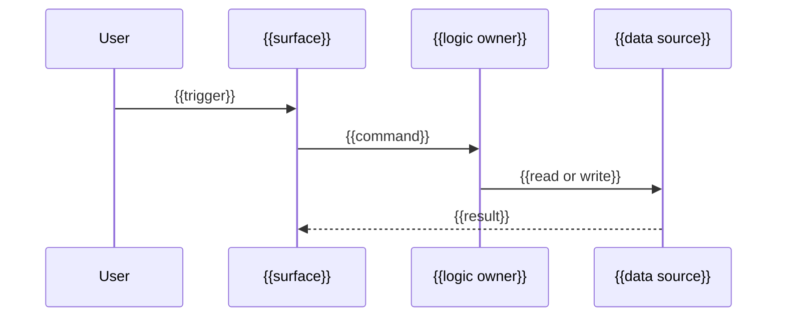

<!-- Author guidance is in HTML comments. Strip every HTML comment when writing the doc. {{…}} is fill-in. Follow writing-style.md in the skill folder. -->

<!-- Seed basename business-logic.md stays on disk (R6). Emitted filename is {{feature-slug}}.logic.md (R2 (short roles only)). Write this after reading each module in {{feature-slug}}.spec.md Touched paths. Each rule names the file it is expected to change, and the existing symbol when there is one. Each workflow step and error case names the function that handles it, when that function exists or is about to be added. Rules are binding; paths are advisory. A behaviour {{feature-slug}}.spec.md did not decide is a Q item there, pointed at with > **Open:** Q1 (short name). Do not fill the gap here. -->

# {{Feature title}} — business logic

> Created because: {{one line — for example "6 validation rules and a 3-state transition"}}

Rules for **{{feature-slug}}**. [{{feature-slug}}.spec.md](./{{feature-slug}}.spec.md) owns scope, non-goals, glossary, and decisions; cite them in full form (`see D3 (short name)`).

## TL;DR

<!-- required. At most three one-line bullets. -->

- {{…}}

## Rules

<!-- required. Binding. This is why the file exists. The name in parentheses is used in every citation. Use MUST, MUST NOT, SHOULD. -->

### R1 ({{short name}})

**Lands in:** `{{path}}` › `{{existing symbol, or "new"}}`

- {{The system MUST …}}

> **Preserve:** {{existing behaviour this rule must not break. Omit the callout when there is nothing to preserve.}}

## Actors and entry points

<!-- include when: more than one entry point -->

| Entry point | User action | System response | Handled by |
| ----------- | ----------- | --------------- | ---------- |
| {{surface or API}} | {{action}} | {{result}} | `{{path}}` › `{{fn}}` |

## Workflows

<!-- include when: a multi-step workflow. The diagram is advisory; the numbered steps are binding. -->

### {{Workflow name}}

1. {{step}} — `{{path}}` › `{{fn}}`
2. {{step}} — `{{path}}` › `{{fn}}`
3. {{done state}}

## States and transitions

<!-- include when: the feature has states. Binding. Prefer this table; add a state diagram only when the table is hard to follow. -->

| From | Event | Guard | To | Side effect |
| ---- | ----- | ----- | -- | ----------- |
| {{…}} | {{…}} | {{… or —}} | {{…}} | {{… or —}} |

## Conditions and error cases

<!-- include when: there are validations or error cases. Binding. Short cells; put copy longer than about 10 words in a list under the table. -->

| Rule | Condition | Behaviour | Handled by | User message |
| ---- | --------- | --------- | ---------- | ------------ |
| R1 ({{short name}}) | {{…}} | {{reject / allow / degrade}} | `{{path}}` › `{{fn}}` | {{copy, or —}} |

## Interactions with existing domain

<!-- include when: the feature uses an existing concept -->

- **{{Existing concept}}** (`{{path}}`): {{how this feature uses it}}
