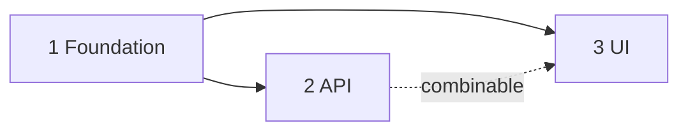

<!-- Author guidance is in HTML comments. Strip every HTML comment when writing the plan. {{…}} is fill-in. Follow writing-style.md in the skill folder. Seed basename implementation-plan.md stays on disk (R6). Emitted filename is {{feature-slug}}.plan.md (G3 (plan extension), R5 (plan body authority)). Phase status lives in this markdown body only — no Cursor YAML todos frontmatter. When Depth is lite, this plan is typically a single phase. -->

# {{Feature title}} — implementation plan

Phases for [{{feature-slug}}.spec.md](./{{feature-slug}}.spec.md).

**Status values:** `Not started` · `Started` · `Reviewing` · `Done` · `Deferred` · `Blocked`

## Progress overview

<!-- required. Depends on and Combinable with are the order gate. — means none. Goal text stays in the phase, not here. -->

<!-- Tier: Low / Medium / High from Phase tier in the spec skill's design-quality.md. Rate the hardest factor in this phase, not the feature and not the file count. The label here matches the phase block. -->

<!-- Close: automated or human, from Phase close in design-quality.md. automated = verify and the one agent review can mark Done with no person. human = after that review, stay Reviewing until a person continues. The cell matches the phase Close line. A combinable group is human if any member is human. -->

| Phase | Status | Name | Tier | Close | Depends on | Combinable with |
| ----- | ---- | ------ | ---- | ----- | ---------- | --------------- |
| **1** | Not started | {{name}} | {{Low / Medium / High}} | {{automated / human}} | — | — |
| **2** | Not started | {{name}} | {{…}} | {{automated / human}} | 1 | 3 |
| **3** | Not started | {{name}} | {{…}} | {{automated / human}} | 1 | 2 |

<!-- include when: more than about five phases. One line, for example "6 phases — migration needs a backfill-verify step before enforcing NOT NULL." -->

{{reason}}

<!-- include when: more than four phases. The table above is the source of truth. Solid arrow = required order. Dashed link = combinable siblings. -->

## Prerequisites

<!-- include when: an external prerequisite blocks a phase (deployed endpoint, env var, access, upstream spec). Omit when there are none. -->

- [ ] {{…}}

## Phase {{n}} — {{name}}

<!-- required. Repeat this block for every phase. Same sections each time. Goal, Read first, Deliverables, Done when, Tier, Close, Gates, and Ask-before feed the serial-SDD phase brief. -->

**Tracker phase:** n/a

<!-- Filled after Linear returns an id (or stays n/a). pending appears briefly while a create call is in flight — see linear-sync/tracker-phases.md. Combinable phases in one dispatch unit share the same value. -->

**Goal:** {{one outcome — what exists when this phase is complete}}

**Covers:** {{G1 (short name), R2 (short name), …}}

**Read first:**

<!-- The tech-doc sections this phase needs, each as a link to its heading. The implementer reads these, {{feature-slug}}.spec.md, and this phase — nothing else from the tech docs. -->

- {{[{{feature-slug}}.contracts.md › TypeName](./{{feature-slug}}.contracts.md#typename)}}

**Tier:** {{Low / Medium / High}} — {{deciding factor, one line}}

**Close:** {{automated / human}}

<!-- Matches the progress overview. human when any Gates owner is human. automated only when every owner is automated. -->

**Not in this phase:** {{adjacent work the implementer must leave alone}}

**Deliverables:**

<!-- Binding. extend, new, or remove. new needs a one-line reason. Prefer extend. -->

- `{{path}}` — extend: {{what changes}}
- `{{path}}` — new, because: {{reason — reused by 2+ callers, existing file would be unwieldy, or a real lifecycle boundary}}
- `{{path}}` — remove: {{what, and why}}

**Approach** (advisory):

<!-- include when: the steps are not obvious from the deliverables. The implementer may deviate and records it in Close-out. -->

1. {{step with real source paths}}

### Sub-tasks

<!-- include when: the phase is too large for one implement session. Each sub-task is one session. -->

| Sub-task | Deliverable | Done when | Status |
| -------- | ----------- | --------- | ------ |
| {{n}}a | `{{path}}` | {{about 10 words, verifiable}} | Not started |

### Acceptance scenarios

<!-- required. Binding. Behaviour only. Read Kind from {{feature-slug}}.spec.md (missing → feature). Feature / missing Kind: Journey title + step, or "Journey: —" when it checks a rule with no journey step. Bugfix: Trace 1:1 to one Current / Expected / Unchanged behaviour item (name the list and item); at least one scenario in the plan has Regression: yes. Check is automated or human, and the same word appears in Gates. -->

- **A{{n}}.1 — {{short title}}**
  - Journey: {{journey title}}, step {{n}}
  <!-- bugfix instead of Journey: use Trace + Regression, e.g. Trace: Expected behaviour › "When … the system shall …" and Regression: yes -->
  - Check: {{automated / human}}
  - Given {{precondition}}
  - When {{action}}
  - Then {{observable result}}

### Done when

<!-- required. Binding. The tier selects the default Verify tiers row. Add a stronger command on its own line when this phase needs one (config, dependency, or generated types that only a full build catches). That does not change the tier. Who runs each line is Gates, not this list. When some scenarios are human, put those IDs on their own line. -->

- [ ] Tier verify passes (Project conventions in `spec_docs/README.md`)
- [ ] A{{n}}.1–A{{n}}.x pass
- [ ] {{regression: existing behaviour X unchanged}}

### Gates

<!-- required. Binding. One row per check. Owner is automated or human. Every scenario Check appears here (a shared owner may be a range). Close is human when any owner is human. Do not add a row for the implement review subagent — that review always runs. A cell is about 10 words. Omit a human row only when Close is automated and no person check exists. -->

| Check | Owner | Evidence |
| ----- | ----- | -------- |
| {{Low verify command}} | automated | Close-out command result |
| A{{n}}.1–A{{n}}.x | {{automated / human}} | {{Close-out, or unchecked until continue}} |

**Ask-before:** {{— or the person stop for this phase}}

<!-- — means no phase-specific stop. Branch, commit, a new dependency, and the other global stops in implement.md still apply. Do not copy those onto every phase. -->

### Close-out

<!-- The implementer fills this at Reviewing, Done, or Blocked. Leave the lines blank until then. Fill Blocked only when status is Blocked: reason, date, and the last failing command. Bugfix + Regression: yes on a scenario → Verified MUST include red-before-green for that scenario: red (named command or repro failed without the fix); green (same check passed with the fix). Green-only for that scenario is a defect. Does not force TDD for every phase. -->

- Verified:
- Deviations:
- Follow-ups:
- Blocked:

## Follow-ups

<!-- include when: a row exists. The implementer logs an out-of-scope finding here instead of fixing it in the current phase. Destination is a later phase, a new spec, or a work item. -->

| Added | Found in phase | Task | Destination |
| ----- | -------------- | ---- | ----------- |
| {{date}} | {{n}} | {{…}} | {{…}} |

## Risks

<!-- include when: the risk changes approach, sequencing, or testing -->

- **{{Risk}}.** Mitigation: {{…}}

## Decisions

<!-- include when: a decision made while planning or implementing is not already in {{feature-slug}}.spec.md. Continue the {{feature-slug}}.spec.md ID sequence. Do not reuse an ID. No index table. -->

### D{{n}} ({{short name}}) — {{decision in one line}}

- **Date:** {{…}} · **Area:** {{…}}
- **Why:** {{…}}
- **Rejected:** {{alternatives, or omit the line}}
