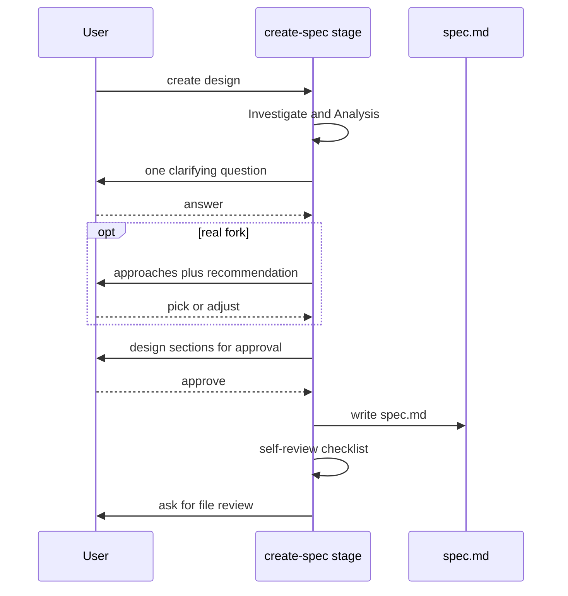

# Adapt Superpowers — business logic

> Created because: create-spec gains a multi-step chat gate, and plan Approach needs binding shape rules.

Rules for **adapt-superpowers**. [spec.md](./spec.md) owns scope, non-goals, glossary, and decisions; cite them in full form (`see D2 (chat before file)`).

## TL;DR

- Create-spec must finish dialogue and chat approval before writing `spec.md`.
- UI-primary designs must carry screen depth in the design file; detection stays open.
- Plan Approach must guide with examples and must not ship pasteable full code; stages must refuse surprise SCM.

## Rules

### R1 (one question)

**Lands in:** `skills/spec/stages/create-spec.md` › Clarify before writing

- After Investigate and Analysis, the agent MUST ask only missing clarifying questions.
- It MUST ask one question per turn when answers are still missing.
- It SHOULD prefer multiple choice when the options are clear.
- It MUST NOT create `spec.md` while required answers are still missing, unless the user says to proceed with recorded assumptions (see R4 (assumptions path)).

> **Preserve:** Skip questions the input or chat already answered. Keep today's must-ask topics (v1 scope, out-of-scope, slug, persistence) unless already answered.

### R2 (approach round)

**Lands in:** `skills/spec/stages/create-spec.md` › new Approach round (after Clarify)

- When the feature has a real fork, the agent MUST propose two or three approaches with trade-offs and a recommendation before presenting the design for approval.
- When there is no meaningful fork, the agent MUST NOT invent fake options (see D3 (skip empty approaches)).
- The approach round MUST finish before sectional design approval (R3 (sectional approval)).

### R3 (sectional approval)

**Lands in:** `skills/spec/stages/create-spec.md` › new Chat design approval (before Write spec.md)

- The agent MUST present the design in short chat sections scaled to complexity.
- It MUST ask for approval after sections, not only after the file exists (see D2 (chat before file)).
- It MUST NOT write `spec.md` until the user approves the design shape, or takes the assumptions path in R4 (assumptions path).

### R4 (assumptions path)

**Lands in:** `skills/spec/stages/create-spec.md` › Clarify before writing / Write spec.md

- If the user says to proceed with assumptions, the agent MUST record those assumptions as **Open questions** or **Decisions** in `spec.md`.
- Only then MAY it write the file.
- Unsettled forks that would change later docs MUST stay **Priority** `high` open questions.

### R5 (self review)

**Lands in:** `skills/spec/stages/create-spec.md` › Stop (extend before file-review ask)

- After writing `spec.md` and before asking for file review, the agent MUST check for placeholders, contradictions, scope leaks into non-goals, and bare ID citations.
- Cheap failures MUST be fixed in the same turn.
- Failures that need a person MUST be called out in the review ask.

### R6 (ui depth)

**Lands in:** `skills/spec/stages/create-spec.md` › Write spec.md; `skills/spec/templates/spec.md` › User journeys / optional UI-primary prompts

- When the feature is UI-primary, the written `spec.md` MUST cover layout regions, main interactions, empty and error states, and glance versus control when both exist (see D4 (ui at design)).
- Component props and wireframes MUST stay out of `spec.md`; they belong in `ui.md` at promote.
- Non-UI features keep journeys as `n/a` with a reason, as today.

> **Open:** Q1 (ui trigger) — how create-spec decides UI-primary is unsettled. Do not invent a detector until that question closes.

### R7 (plan guiding)

**Lands in:** `skills/spec/stages/plan.md` › What to write (Approach); `skills/spec/design-quality.md` › Ready to implement / Bad vs good

- Phase **Approach** MUST be richer than path-and-order alone when shape would otherwise be ambiguous: guiding code, do/do-not examples, and code-design notes (see D5 (guided plan, not paste)).
- Approach remains advisory; Done when and acceptance scenarios stay the binding check.
- Phase size MUST stay outcome-based. Approach MUST NOT default to 2–5 minute micro-steps.
- TDD MUST NOT be required by the skill unless **Project conventions** say so.

### R8 (no pasteables)

**Lands in:** `skills/spec/stages/plan.md` › What to write (Approach); `skills/spec/design-quality.md`

- Approach MUST NOT ship full implementation blocks meant to be pasted into the repo without further design (glossary: pasteable code).
- Guiding code MUST stay short: signatures, sketches, or snippets that show shape, not a drop-in file.

### R9 (no scm)

**Lands in:** `skills/spec/SKILL.md`; `skills/spec/stages/implement.md` › Session checklist / Ask before; `skills/spec/stages/create-spec.md` and `skills/spec/stages/plan.md` briefly

- The skill MUST NOT create branches, worktrees, or commits unless the user explicitly asks in that conversation (see D6 (no scm)).
- Create, promote, and implement MUST NOT add a worktree creation step.
- Existing user or project git rules still apply; the skill MUST NOT invent commits to "help."

### R10 (one skill)

**Lands in:** `skills/spec/SKILL.md`

- Adaptations MUST land in the existing `spec` skill tree (see D1 (one skill)).
- The skill MUST NOT add peer skills for brainstorming, planning, or TDD for this design.
- After design-file approval, the skill MUST NOT auto-invoke a separate implementation pipeline (see D7 (no hooks)).

## Actors and entry points

| Entry point | User action | System response | Handled by |
| ----------- | ----------- | --------------- | ---------- |
| `/spec` create | Ask for a new design | Dialogue, then chat approval, then file | `create-spec.md` |
| `/spec` create (UI-primary) | Same, screen is main surface | Plus screen depth in `spec.md` | `create-spec.md` + template |
| `/spec` promote plan | Ask for implementation plan | Phases with guided Approach | `plan.md` + `design-quality.md` |
| `/spec` implement | Ask to run a phase | Edit product files; no surprise SCM | `implement.md` |

## Workflows

### Create-spec chat gate

1. Investigate and Analysis run as today — `skills/spec/stages/create-spec.md` › Investigate / Analysis.
2. Ask missing clarifications one at a time — R1 (one question).
3. Optional approach round when there is a real fork — R2 (approach round).
4. Present design in chat; get sectional approval — R3 (sectional approval).
5. Write `spec.md` only after approval or the assumptions path — R3 (sectional approval), R4 (assumptions path).
6. Self-review, then ask for file review — R5 (self review).
7. For UI-primary work, the written design includes screen depth — R6 (ui depth).

### Promote plan as guided contract

1. Preconditions stay: `Progress: tech`, no placeholders or suggestions — `skills/spec/stages/plan.md` › Preconditions.
2. Write phases with goals, deliverables, Done when, and scenarios — as today.
3. Fill Approach with paths, order, guiding snippets, and do/do-not examples when shape is ambiguous — R7 (plan guiding).
4. Reject pasteable full implementations in Approach — R8 (no pasteables).
5. Hand off for review before implement — as today.

## States and transitions

Binding for the create-spec chat gate only. File Progress gates in `spec.md` are unchanged.

| From | Event | Guard | To | Side effect |
| ---- | ----- | ----- | -- | ----------- |
| Investigating | Analysis done | — | Clarifying | — |
| Clarifying | Answer received | More must-ask open | Clarifying | Next question |
| Clarifying | Answers complete | Real fork | Approaching | Show options |
| Clarifying | Answers complete | No fork | Approving design | Skip approach round |
| Approaching | User picks or adjusts | — | Approving design | — |
| Approving design | Section rejected | — | Approving design | Revise that section |
| Approving design | Design approved | — | Writing file | Create `spec.md` |
| Clarifying or Approving design | User: proceed with assumptions | — | Writing file | Record Q/D items |
| Writing file | Self-review pass | — | File review ask | Ask user to review file |
| Writing file | Cheap self-review fail | — | Writing file | Fix in same turn |

## Conditions and error cases

| Rule | Condition | Behaviour | Handled by | User message |
| ---- | --------- | --------- | ---------- | ------------ |
| R1 (one question) | Must-ask still open | Hold file write | `create-spec.md` › Clarify | Ask the missing item |
| R2 (approach round) | No meaningful fork | Skip round | `create-spec.md` › Approach round | — |
| R3 (sectional approval) | File write before approval | Forbidden | `create-spec.md` › Chat design approval | Continue dialogue |
| R4 (assumptions path) | User skips Q&A | Record then write | `create-spec.md` › Clarify | Confirm assumptions recorded |
| R5 (self review) | Placeholder or bare ID | Fix or call out | `create-spec.md` › Stop | Name remaining defects |
| R6 (ui depth) | UI-primary and screen undescribed | Design incomplete | `create-spec.md` › Write | Fail review until filled |
| R8 (no pasteables) | Full paste-ready code in Approach | Forbidden | `plan.md` › Approach | Trim to guiding snippets |
| R9 (no scm) | Agent would create branch/worktree/commit | Refuse | `implement.md` / `SKILL.md` | Ask user to request explicitly |

## Interactions with existing domain

- **Progress gates** (`skills/spec/SKILL.md`): Unchanged. Chat approval is inside create-spec at `Progress: design`. It does not add a new Progress value.
- **Clarify before writing** (`skills/spec/stages/create-spec.md`): Today's must-ask list stays. This design inserts approach and sectional approval between clarify and Write spec.md.
- **Approach (advisory)** (`skills/spec/stages/plan.md`): Remains advisory. R7 (plan guiding) and R8 (no pasteables) change what "enough Approach" means.
- **Ask before git** (`skills/spec/stages/implement.md`): Already asks before commit / push / PR. R9 (no scm) extends that to branches and worktrees, and forbids unsolicited SCM in create and promote too.
- **Packaging README** (`README.md`): Notes that adapt-superpowers behaviour is reserved. After implement, that line should reflect shipped dialogue and plan-contract changes — docs only, not a rule owner.
