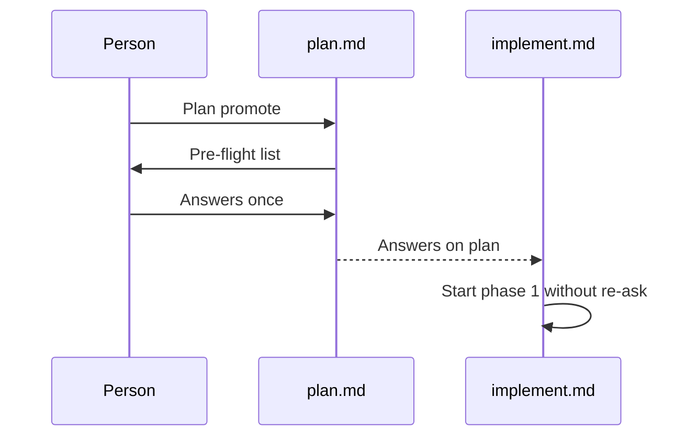
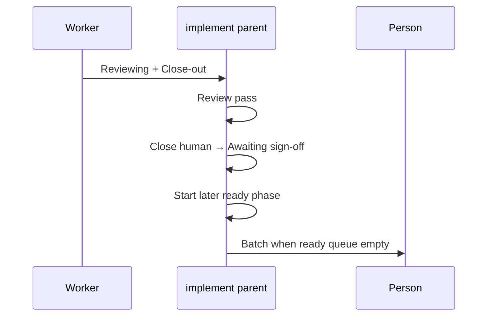

# Defer human gates — business logic

> Created because: multi-step implement workflows and non-obvious phase status transitions (pre-flight, awaiting sign-off, blocked dependents, batched sign-off, cascade reopen)

Rules for **defer-human-gates**. [defer-human-gates.spec.md](./defer-human-gates.spec.md) owns scope, non-goals, glossary, and decisions; cite them in full form (`see D3 (depends marker)`).

## TL;DR

- Predictable person inputs are answered once before phase 1 and not re-asked.
- After agent review, Close `human` moves to `Awaiting sign-off` and frees the active slot.
- Blocked or awaiting phases stall only the dependents that still need them; leftover sign-offs batch when the ready queue is empty.

## Rules

### R1 (pre-flight collect)

**Lands in:** `skills/spec/stages/plan.md` › What to write (new)

- The plan stage MUST collect every person input it can predict into one pre-flight list before phase 1 may start.
- Predictable inputs include a new dependency, a new command, a secret name, and branch or cloud consent when the plan can foresee them.
- The person MUST answer that list once before the first phase starts.
- Answers MUST be recorded on the plan in the top-level Pre-flight section (see D5 (pre-flight home)).

> **Preserve:** Global Ask-before stops in `skills/spec/stages/implement.md` still exist for unpredicted items.

### R2 (no re-ask)

**Lands in:** `skills/spec/stages/implement.md` › Ask before / Stop and resume

- The runner MUST NOT re-ask a pre-flight item whose answer is already recorded on the plan.
- During the run, only an unpredicted person input MAY stop the runner for Ask-before.

### R3 (awaiting after review)

**Lands in:** `skills/spec/stages/implement.md` › Review gate · Phase status

- After verify and the agent review pass, a unit with Close `human` MUST move to `Awaiting sign-off` (see D2 (status name)).
- The runner MUST NOT leave that unit in `Reviewing` as the sole active halt after that pass.

> **Preserve:** Close `automated` still becomes `Done` on review pass. The one review-subagent rule stays.

### R4 (active slot)

**Lands in:** `skills/spec/stages/implement.md` › Serial SDD · Phase status

- `Awaiting sign-off` MUST NOT count against the one-active-unit rule.
- Only one unit MAY be `Started`, `Reviewing`, or `Blocked` at a time.
- Parallel implementers MUST NOT run.

### R5 (depends default)

**Lands in:** `skills/spec/stages/implement.md` › Phase selection

- By default, a Depends on entry whose target is `Awaiting sign-off` MUST satisfy that dependency so a later phase may start.
- When the plan marks that entry as needs sign-off (see D3 (depends marker)), the dependent MUST wait until the person accepts the earlier phase (`Done`).
- Marker spelling is a suffix on the phase id (see D4 (marker syntax)), for example `1 (needs sign-off)`.

### R6 (sign-off defaults)

**Lands in:** `skills/spec/design-quality.md` › Phase close (extend)

- Design-quality guidance MUST default needs sign-off for migrations, stored data, auth, and secrets.
- Visual and copy checks SHOULD default to unmarked (can wait).
- Design-quality guidance MUST place human-checked work as late as the dependencies allow.

### R7 (blocked dependents)

**Lands in:** `skills/spec/stages/implement.md` › Phase selection · Serial SDD

- When a phase is `Blocked`, phases that do not depend on it MAY still start (subject to R4 (active slot) and their own Depends on).
- A phase whose Depends on includes a blocked phase MUST NOT start until that dependency is cleared.

### R8 (batched sign-off)

**Lands in:** `skills/spec/stages/implement.md` › Stop and resume

- When no ready phase remains, the runner MUST list every pending human gate across phases that are `Awaiting sign-off`.
- One reply MAY accept all of them, or name the ones it accepts.
- Accepted phases MUST move to `Done`.
- Rejected phases MUST follow R9 (cascade reopen).

### R9 (cascade reopen)

**Lands in:** `skills/spec/stages/implement.md` › Stop and resume (new)

- On reject, the runner MUST reopen the rejected phase (blocked or back to reviewing per implement rules).
- It MUST also reopen every later phase that ran while that phase was `Awaiting sign-off` (see D1 (cascade reopen)).

### R10 (archive wait)

**Lands in:** `skills/spec/stages/implement.md` › Archive · `skills/spec/stages/linear-sync/status.md` › Archive gate

- Archive MUST wait until every phase is `Done` or `Deferred`.
- No phase MAY remain in `Awaiting sign-off`.

### R11 (secret names only)

**Lands in:** `skills/spec/stages/implement.md` · plan Close-out · Linear bodies

- Secret values MUST NOT be written into the plan, Close-out, or Linear.
- Record the secret name only.

## Actors and entry points

| Entry point | User action | System response | Handled by |
| ----------- | ----------- | --------------- | ---------- |
| Plan promote | Approve plan stage | Build pre-flight list; record answers | `skills/spec/stages/plan.md` |
| Implement / continue | Run next unit | Select ready unit; skip recorded pre-flight | `skills/spec/stages/implement.md` › Phase selection |
| Review pass | Agent review succeeds | Close `human` → `Awaiting sign-off` | `skills/spec/stages/implement.md` › Review gate |
| Batched sign-off | Accept / reject when queue empty | Done or cascade reopen | `skills/spec/stages/implement.md` › Stop and resume |
| Archive | Confirm archive | Refuse while any `Awaiting sign-off` | `skills/spec/stages/implement.md` › Archive |
| Validate | Run validate script | Report bad status, marker, pre-flight shape | `skills/spec/scripts/validate` |

## Workflows

### Pre-flight then run

1. Plan stage builds the pre-flight list from predictable Ask-before items — `skills/spec/stages/plan.md`.
2. Person answers once; answers are stored on the plan — R1 (pre-flight collect), D5 (pre-flight home).
3. Implement skips recorded items and stops only for unpredicted Ask-before — R2 (no re-ask).

### Review to awaiting then independent work

1. Worker finishes verify and sets `Reviewing` — existing Session checklist.
2. Parent review passes. Close `human` → `Awaiting sign-off` — R3 (awaiting after review).
3. Slot frees. Later phase may start when Depends on allows — R4 (active slot), R5 (depends default).
4. When nothing else can run, batch every pending sign-off — R8 (batched sign-off).

### Reject after cascade work

1. Person rejects a phase in the batch — R8 (batched sign-off).
2. Rejected phase reopens — R9 (cascade reopen).
3. Every later phase that ran while it was awaiting also reopens — D1 (cascade reopen).

## States and transitions

| From | Event | Guard | To | Side effect |
| ---- | ----- | ----- | -- | ----------- |
| Started | Verify + Close-out done | — | Reviewing | Worker write-back |
| Reviewing | Review pass | Close `automated` | Done | May auto-continue next unit |
| Reviewing | Review pass | Close `human` | Awaiting sign-off | Frees active slot |
| Reviewing | Review fail after fix budget | — | Blocked | Close-out Blocked line |
| Awaiting sign-off | Person accepts (batch or named) | — | Done | Record Close-out acceptance |
| Awaiting sign-off | Person rejects | — | Reviewing or Blocked | Cascade reopen later work |
| Blocked | Continue / clear | Dependency cleared | Started or stays | Independents may already run |
| Any open | Archive confirm | All Done or Deferred | archived Progress | Refuse if any Awaiting sign-off |

## Conditions and error cases

| Rule | Condition | Behaviour | Handled by | User message |
| ---- | --------- | --------- | ---------- | ------------ |
| R1 (pre-flight collect) | Phase 1 start with unanswered pre-flight | stop | `plan.md` / implement start | Present unanswered pre-flight list |
| R2 (no re-ask) | Unpredicted Ask-before mid-run | stop | `implement.md` › Stop and resume | Ask that item only |
| R5 (depends default) | Dependent needs sign-off; target awaiting | do not start | `implement.md` › Phase selection | Name the blocking Depends on entry |
| R7 (blocked dependents) | Depends on includes Blocked | do not start | `implement.md` › Phase selection | Name the blocked dependency |
| R8 (batched sign-off) | Ready queue empty; awaiting remain | batch prompt | `implement.md` › Stop and resume | List all pending human gates |
| R9 (cascade reopen) | Reject after later work ran | reopen chain | `implement.md` › Stop and resume | Name reopened phases |
| R10 (archive wait) | Any `Awaiting sign-off` | refuse archive | `implement.md` › Archive | Finish or defer sign-offs first |
| R11 (secret names only) | Secret value would be written | reject write | implement / plan / Linear | Record name only |

## Interactions with existing domain

- **Ask-before** (`skills/spec/stages/implement.md`, phase **Ask-before**): Pre-flight pulls predictable items forward. Unpredicted items still halt mid-run.
- **Close** (`skills/spec/design-quality.md` › Phase close): Still chooses automated vs human finish. Human finish no longer holds `Reviewing` as the active unit after review pass.
- **Depends on** (plan progress overview): Gains an optional needs-sign-off mark. Unmarked awaiting satisfies the cell; marked waits for person accept.
- **One active unit** (`implement.md` › Serial SDD): Still one of `Started` / `Reviewing` / `Blocked`. `Awaiting sign-off` is outside that set.
- **Tracker Phase status map** (`linear-sync/status.md`, Project conventions): Gains a key for `Awaiting sign-off`. Archive gate treats it as open.
