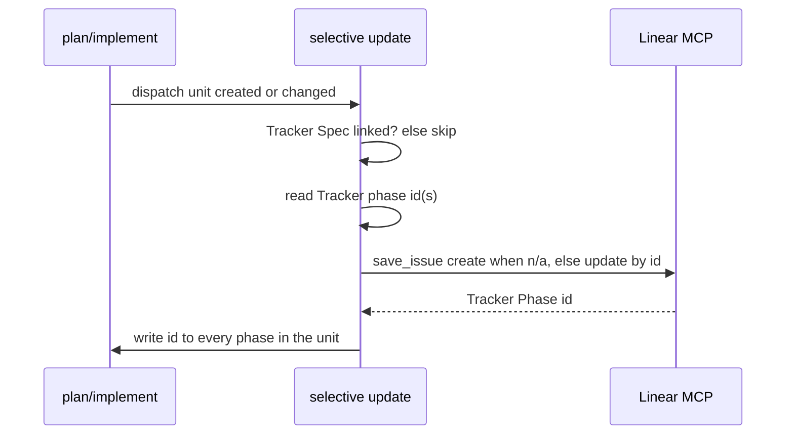

# Linear integration — business logic

> Created because: tracker updates have multi-step workflows, freeze gates, conflict stop, and more than five binding rules.

Rules for **linear-integration**. [spec.md](./spec.md) owns scope, non-goals, glossary, and decisions; cite them in full form (`see D3 (reject bidirectional)`).

## TL;DR

- Linear is a tracker and one-way mirror. The repo stays binding after the folder exists.
- Tracker Spec identity is the `Work item:` field in `spec.md`; Tracker Phase identity is each plan phase’s `Tracker phase:` field.
- Selective updates run only on linked objects, with conventions filled and Linear MCP in the session. Explicit `/spec linear sync` creates missing objects and repairs references.
- “Do not edit in Linear” banners, human-gated Cursor assign, and MCP-session skip keep dual canon, surprise launch, and false cloud sync out of v1.

## Rules

### R1 (conventions gate)

**Lands in:** `skills/spec/stages/create-spec.md` › Input / Write; new `skills/spec/stages/linear-sync.md` › Preconditions

- Before a Linear operation, the skill MUST read **Work items** under **Project conventions** and require only the fields that operation uses: fetch instructions for create-from, team/project for create, and the relevant state map for a status update (see D12 (minimal conventions)).
- If a write or explicit create is requested and Linear MCP or required conventions are missing, the skill MUST warn once and MUST NOT invent a project, team, state map, or silent half-link (G1 (create from linear), D19 (mcp session), R21 (mcp session), R22 (reference gate)).
- Create-spec MAY still write `spec.md` with `Work item` set after a successful fetch; only the write-back path stops.

### R2 (no body rewrite)

**Lands in:** `skills/spec/stages/create-spec.md` › Write; `skills/spec/stages/linear-sync.md` › Link-back

- The skill MUST NOT replace the Tracker Spec description with the full spec or with binding AC from the repo (G1 (create from linear), G7 (repo canonical), D3 (reject bidirectional)).
- Link-back uses a comment that may name the repo path, optional labels, and Linear `links` only when a real URL exists.

> **Preserve:** Create-spec still maps Linear AC onto goals’ `Source:` lines once at create. It does not paste the raw payload into `spec.md`.

### R3 (first link back)

**Lands in:** `skills/spec/stages/create-spec.md` › Write; `skills/spec/stages/linear-sync.md` › Link-back

- On the first successful link (`Work item` set and write-back allowed), the skill MUST post a comment that names `spec_docs/<slug>/` (G1 (create from linear)).
- The skill MUST NOT append a Linear `links` row unless the URL is a real URI (for example a hosted remote). A bare repo path is not a link.
- After Linear returns the Tracker Spec, the skill MUST write its real URL into `spec.md` (D17 (repo-stored tracker ids)).
- When conventions define a design-stage label, the skill MUST add it with `addLabels` (not a full label replace).
- Document mirror create follows G5 (document mirror) and D15 (document trigger).

### R4 (freeze before plan)

**Lands in:** `skills/spec/stages/plan.md`; `skills/spec/stages/linear-sync.md` › Tracker Phase create

- The skill MUST NOT create Tracker Phases while `implementation-plan.md` is missing (G2 (tracker phases), D4 (freeze after plan)).
- Prefer create/refresh when the plan is written or its phase list changes. Fallback is at or just before first implement.

### R5 (thin noop)

**Lands in:** `skills/spec/stages/linear-sync.md` › Tracker Phase create

- If the folder has no `implementation-plan.md`, Tracker Phase creation MUST be a no-op (G6 (thin noop)).
- Tracker Spec link-back, Progress-based status/labels, and the Document mirror MAY still run when the folder has a Tracker Spec id (R22 (reference gate)).

### R6 (repo-stored phase identity)

**Lands in:** `skills/spec/stages/linear-sync.md` › Tracker Phase update

- Every implementation-plan phase MUST contain `Tracker phase: <work item id> | n/a` (G2 (tracker phases), D17 (repo-stored tracker ids)).
- `n/a` means there is no linked Tracker Phase yet. On creation, the returned id MUST be written into the field immediately.
- One Tracker Phase maps to one dispatch unit. Every phase in a combinable group MUST store the same Tracker Phase id.
- Updates MUST address Tracker Phases by the stored id, never by title search or a hidden Linear-description marker.

### R7 (unreferenced leave)

**Lands in:** `skills/spec/stages/linear-sync.md` › Tracker Phase update

- Linear work items not referenced by `Work item:` or `Tracker phase:` are human-owned. The skill MUST NOT delete, cancel, or rewrite their titles or bodies (G2 (tracker phases)).

### R8 (direct and selective update)

**Lands in:** `skills/spec/stages/linear-sync.md` › Selective update / Explicit sync

- Routine events MUST update only the affected Tracker Spec or Tracker Phase by its stored id. They MUST NOT run a full sync.
- Explicit `/spec linear sync` MUST create objects whose repo field is `n/a`, update referenced objects, and repair invalid references. If project, team, mapping, or ownership information is missing, it MUST ask rather than infer.
- A valid stored id MUST update in place. The skill MUST NOT create a duplicate because a title or phase number changed.

### R9 (cancel removed)

**Lands in:** `skills/spec/stages/plan.md` › Plan edit; `skills/spec/stages/linear-sync.md` › Tracker Phase update

- When a plan edit removes a dispatch unit with a stored Tracker Phase id, the skill MUST cancel that known Tracker Phase and comment with the reason before removing the repo reference. It MUST NOT silent-delete the work item.
- A later explicit sync MUST NOT scan Linear to guess which unreferenced work item used to belong to a removed phase.

### R10 (flat phases)

**Lands in:** `skills/spec/stages/linear-sync.md` › Tracker Phase create

- New Tracker Phases MUST set Linear’s API `parentId` to the Tracker Spec id by default (D10 (flat phases)). `parentId` is an external API field, not domain terminology used in these docs.
- Nesting under an Implementation container MUST NOT be the v1 default.

### R11 (status mirror)

**Lands in:** `skills/spec/stages/implement.md` › Phase status / Archive; `skills/spec/stages/linear-sync.md` › Status sync

- Tracker Spec state and labels MUST follow `Progress` in `spec.md` via the conventions state map (G3 (status mirror)).
- Tracker Phase state MUST follow that unit’s plan phase status (`Not started` … `Blocked`).
- Combined phases that share a Tracker Phase id MUST be updated once using the dispatch unit’s status.
- Linear status MUST NOT drive plan status or Progress (G7 (repo canonical)).

### R12 (selective tracker writes)

**Lands in:** `skills/spec/stages/plan.md`; `skills/spec/stages/implement.md`; `skills/spec/stages/linear-sync.md`

- When Linear is linked and conventions exist, a gate change MUST update only the Tracker Spec and a plan-status change MUST update only that Tracker Phase (D5 (selective tracker writes)).
- The skill MUST NOT require a confirm prompt on every phase Done or run full `/spec linear sync` for a routine change.
- Gate review asks in chat MAY add a comment. They MUST NOT invent a Linear approval workflow (G3 (status mirror)).

### R13 (progress log)

**Lands in:** `skills/spec/stages/linear-sync.md` › Status sync

- When Progress or a referenced Tracker Phase’s plan status actually changes, the skill MUST post a **new** Tracker Spec comment summarizing what changed (G3 (status mirror), D18 (append progress)).
- Sync MUST NOT edit prior progress comments in place.
- Sync MUST NOT post a progress comment on a no-op explicit sync (no Progress / Tracker Phase status delta).

### R14 (conflict stop)

**Lands in:** `skills/spec/stages/linear-sync.md` › Conflict check

- Document and issue bodies MUST carry the “do not edit in Linear” / repo-canonical banner (D16 (no linear edits), G7 (repo canonical)).
- When a Linear prose conflict is known, the skill MUST warn and offer D20 (conflict choices) before overwriting mirrored surfaces (D6 (conflict stop), D9 (keep conflict stop)).
- v1 MUST NOT require a body-hash tripwire. Automatic detection only if Q1 (auto detect) lands a trivial method.
- Status-only updates and new progress comments that leave the issue body alone are not blocked.

### R15 (cloud ready body)

**Lands in:** `skills/spec/stages/linear-sync.md` › Tracker Phase body; reuses `skills/spec/stages/implement.md` › Phase brief

- Tracker Phase descriptions MUST include brief-quality fields aligned with the implement stage phase brief and env checklist cues (G4 (cloud ready phases); archived multi-subagent contracts).
- The body MUST state that the repo is canonical and that the agent MUST NOT invent scope from the Linear description beyond Done when.
- When conventions set a default remote, the body MUST include `[repo=…]` (D14 (default repo)).

### R16 (human gated launch)

**Lands in:** `skills/spec/stages/linear-sync.md` › Tracker Phase body; `skills/spec/SKILL.md` › Infer table

- v1 MUST use Cursor’s native assign / `@Cursor` path (D7 (native cloud kickoff)).
- The skill MUST NOT auto-assign or auto-`delegate` Cursor on Tracker Phases (D13 (human gated)).
- The skill MAY offer “mark Tracker Phase ready to delegate” (status/label only). It MUST NOT add a second Cloud Agent launcher API.
- Linear-started cloud inherits cloud consent per multi-subagent G6 (scm consent). Extra branch, worktree, or commit still needs an ask unless that runner’s normal story applies.
- Linear-started cloud MUST NOT be treated as having performed Linear tracker write-back. Catch-up follows D19 (mcp session) / R21 (mcp session).

### R17 (document mirror)

**Lands in:** `skills/spec/stages/linear-sync.md` › Document mirror

- On first successful Tracker Spec link, the skill MUST create the Document mirror. It MUST regenerate when a gate change affects TL;DR or goals (G5 (document mirror), D8 (document depth), D15 (document trigger)).
- The Document MUST state it is a mirror: edit binding content in the repo, not in Linear (D16 (no linear edits)).
- Regeneration is one-way repo → Linear. It MUST NOT pull Linear prose into `spec.md`.
- After create, the skill MUST store Document id and Document URL in `spec.md` (D17 (repo-stored tracker ids)).
- Status-only updates MUST NOT regenerate the Document.

### R18 (archive gate)

**Lands in:** `skills/spec/stages/implement.md` › Archive; `skills/spec/stages/linear-sync.md` › Status sync

- On archive, the skill MUST set the Tracker Spec to Done only when every referenced Tracker Phase is Done or Deferred (D11 (archive gate)).
- Otherwise it MUST ask before marking the Tracker Spec Done. Deferred Tracker Phases follow the conventions map.

### R19 (no secrets)

**Lands in:** `skills/spec/stages/linear-sync.md` › All writes

- Sync MUST NOT push secrets, private dumps, or full private docs into Linear comments, Tracker Phases, or Documents (Constraints › Security).
- Document and Tracker Phase text MUST stay summaries and brief fields.

### R20 (routing entry)

**Lands in:** `skills/spec/SKILL.md` › Infer, otherwise ask

- The Infer table MUST recognize `/spec linear sync` (or equivalent create/repair wording) and route to `stages/linear-sync.md` explicit sync.
- Stage hooks in create-spec, plan, implement, and archive MUST call the shared selective-update rules rather than inventing a second doctrine.

### R21 (mcp session)

**Lands in:** `skills/spec/stages/linear-sync.md` › Preconditions; plugin root `README.md`

- Tracker write-back (link-back, Tracker Phases, status, Document, explicit sync) and create-from Linear fetch MUST run only when Linear MCP is usable in the current agent session (D19 (mcp session)).
- Cursor’s Linear product integration (assign / `@Cursor`) MUST NOT be treated as Linear MCP auth. Cloud MCP sign-in is separate from the desktop IDE.
- When a linked-object update or explicit create is requested and Linear MCP is missing or unauthorized, the skill MUST follow R1 (conventions gate): warn once and skip write-back. It MUST NOT invent a second Linear API or fail the implement unit solely because Linear could not sync.
- Implement MUST document this operator model in the plugin root `README.md` (Notes › Plugin README in `spec.md`).

### R22 (reference gate)

**Lands in:** `skills/spec/stages/linear-sync.md` › Preconditions

- Routine writes require a stored id: Tracker Spec updates require `Work item: <id>`; Tracker Phase updates require `Tracker phase: <id>`.
- Routine hooks MUST skip a field whose value is `n/a`; they MUST NOT silently create tracker work as a side effect of an unrelated gate or status change.
- Explicit `/spec linear sync` is the create/repair exception. It MAY create a Tracker Spec or Tracker Phase whose field is `n/a`, then MUST write the returned id into the repo immediately. It asks for any missing project, team, state-map, or ownership information.
- Missing MCP or required conventions follow R1 (conventions gate) / R21 (mcp session): warn once, skip write-back.

## Actors and entry points

| Entry point | User action | System response | Handled by |
| ----------- | ----------- | --------------- | ---------- |
| Create from issue | `/spec create from TEAM-123` | Fetch, write `spec.md`, link-back | `create-spec.md` + `linear-sync.md` |
| Create from repo | `/spec linear sync` with `Work item: n/a` | Ask for missing setup, create Tracker Spec, persist id | `linear-sync.md` |
| Plan written | Promote / plan edit | Tracker Phase create/update when plan exists | `plan.md` + `linear-sync.md` |
| Phase status change | Implement / SDD continue | Affected Tracker Phase + Tracker Spec progress comment | `implement.md` + `linear-sync.md` |
| Explicit sync | `/spec linear sync` | Create missing, update referenced, repair invalid fields; ask for missing information | `linear-sync.md` › Explicit sync |
| Archive | User confirms archive | Archive gate; Tracker Spec Done if allowed | `implement.md` › Archive + sync |
| Native cloud | Human assigns / `@Cursor` | Agent reads Tracker Phase brief body; no tracker write-back assumed | Cursor product (not skill launcher); D19 (mcp session) |
| Local catch-up | IDE session with Linear MCP after cloud / plan change | Selective status plus requested explicit sync | `linear-sync.md` |

## Workflows

### Create-from and link-back

```mermaid
sequenceDiagram
    participant User
    participant Create as create-spec
    participant Sync as linear-sync
    participant Linear as Linear MCP

    User->>Create: create from TEAM-123
    Create->>Linear: get_issue
    Create->>Create: write spec.md Work item
    Create->>Sync: link-back if conventions OK
    Sync->>Linear: save_comment / optional real URL links / addLabels
    Note over Sync: Document path per D15; store ids and URLs in spec.md
```

1. Fetch issue via conventions → Linear MCP — `create-spec.md` › Input
2. Run create-spec dialogue; write `spec.md` with `Work item` — `create-spec.md` › Write
3. If conventions/MCP missing for write-back: warn once; stop write-back — R1 (conventions gate)
4. Post link-back comment; optional real URL `links`; optional design label; store Tracker Spec URL in `spec.md` — R3 (first link back)
5. Do not rewrite issue description — R2 (no body rewrite)
6. Document create — R17 (document mirror); D15 (document trigger)
7. Persist Document id + Document URL in `spec.md` — D17 (repo-stored tracker ids)

### Tracker Phase create and update



1. Guard: routine hook with `Work item: n/a` → skip; explicit sync may create the Tracker Spec first — R22 (reference gate)
2. Guard: no plan → no-op Tracker Phases — R5 (thin noop)
3. Read the changed dispatch unit and its `Tracker phase:` field(s) — R6 (repo-stored phase identity)
4. If `n/a`, create one Tracker Phase using Linear API `parentId` = Tracker Spec id, then write the returned id to every phase in the unit.
5. If an id exists, update that Tracker Phase directly. Do not scan `list_issues` or descriptions for markers — R8 (direct and selective update).
6. Leave unreferenced Linear work alone — R7 (unreferenced leave).
7. On plan removal, cancel the still-known Tracker Phase before deleting the repo reference — R9 (cancel removed).
8. Refresh brief-quality bodies on create or when their source fields change — R15 (cloud ready body).

### Selective status update and progress log

1. On a gate change, map `Progress` → Tracker Spec state/labels via conventions — R11 (status mirror).
2. On a phase-status change, map that dispatch unit → its Tracker Phase state via conventions — R11 (status mirror).
3. If Progress or Tracker Phase status actually changed, post a new Tracker Spec progress comment — R13 (progress log).
4. Skip per-Done confirm and do not run a full sync — R12 (selective tracker writes).

### Conflict stop before mirror overwrite

1. Mirror banners state do not edit binding content in Linear — D16 (no linear edits), R14 (conflict stop)
2. When a conflict is known: warn and offer D20 (conflict choices) — D6 (conflict stop)
3. No required hash tripwire in v1 — Q1 (auto detect)
4. Status updates and new progress comments that do not touch the issue body MAY continue

### Archive gate

1. User confirms archive — `implement.md` › Archive
2. Check every referenced Tracker Phase is Done or Deferred — R18 (archive gate)
3. If incomplete: ask; do not silently complete the Tracker Spec
4. Move folder; set `Progress: archived`; update Tracker Spec state/labels when allowed

## States and transitions

**In short:** Repo Progress and plan phase status own the truth. Linear states are mapped outputs.

### Spec Progress → Tracker Spec (via conventions map)

| From (Progress) | Event | Guard | To (Tracker Spec) | Side effect |
| --------------- | ----- | ----- | ------------------ | ----------- |
| — | First link | Conventions present | design-stage state/label | Link-back comment / links |
| `design` | Promote tech | Linked | tech map entry | Progress comment |
| `tech` | Promote plan | Linked | plan map entry | Tracker Phase creation may start |
| `plan` / `implementing` | Gate / phase updates | Linked | implementing map entry | Selective Tracker Phase status update |
| any | Archive confirmed | All referenced Tracker Phases Done/Deferred | Done | Progress comment |
| any | Archive incomplete board | Referenced Tracker Phase open | — | Ask; no silent Done |

### Plan phase status → Tracker Phase

| From | Event | Guard | To | Side effect |
| ---- | ----- | ----- | -- | ----------- |
| `Not started` | Create / explicit sync | Stored id or newly returned id | conventions: not started | Write id when created |
| any | Unit `Started` | Stored id | conventions: started | Progress comment |
| `Started` | Worker → `Reviewing` | Stored id | conventions: reviewing | Progress comment |
| `Reviewing` | Implementer → `Done` | Stored id | conventions: done | Progress comment |
| any | → `Deferred` | Stored id | conventions: deferred | Comment optional |
| any | → `Blocked` | Stored id | conventions: blocked | Progress comment notes reason |
| referenced unit | Unit removed from plan | Id still available during edit | Canceled | Cancel comment; R9 |

Exact Linear state *names* live in Project conventions (D12 (minimal conventions)). The table above is the repo-side event model.

## Conditions and error cases

| Rule | Condition | Behaviour | Handled by | User message |
| ---- | --------- | --------- | ---------- | ------------ |
| R22 (reference gate) | Routine hook sees an `n/a` field | Skip that write; do not create implicitly | Preconditions | — |
| R22 (reference gate) | Explicit sync sees an `n/a` field | Create after prerequisites are known; persist returned id | Explicit sync | Ask for missing information |
| R1 (conventions gate) | Linked; MCP or conventions missing | Stop write-back; warn once | `linear-sync.md` › Preconditions | Warn: fill conventions / connect MCP |
| R21 (mcp session) | Linked; session without Linear MCP | Skip write-back; implement may continue | Preconditions + README | Point at local IDE sync / plugin README |
| R2 (no body rewrite) | Tempted to paste full spec into Linear | Reject | Link-back | — |
| R3 (first link back) | No real URL for Linear `links` | Comment only; no fake link | Link-back | — |
| R4 (freeze before plan) | Tracker Phase create before plan exists | No-op | Tracker Phase create | — |
| R5 (thin noop) | No `implementation-plan.md` | No-op Tracker Phases | Tracker Phase create | — |
| R7 (unreferenced leave) | Linear work has no repo field | Leave alone | Selective update | — |
| R8 (direct and selective update) | Field is `n/a` or invalid | Create or ask/repair via explicit sync | Explicit sync | Ask for missing information |
| R14 (conflict stop) | Known Linear prose conflict | Warn; D20 (conflict choices) | Conflict check | Offer regenerate / skip / stop writes |
| R18 (archive gate) | Referenced Tracker Phase not Done/Deferred | Ask before Tracker Spec Done | Archive + sync | Ask |
| R19 (no secrets) | Secret-like content in mirror payload | Omit / refuse | All writes | — |

## Interactions with existing domain

- **Work items create path** (`skills/spec/stages/create-spec.md` › Input): Same fetch and AC→goal mapping; this feature adds write-back after `Work item` is set.
- **Phase brief** (`skills/spec/stages/implement.md` › Phase brief): Tracker Phase bodies reuse that field list for native `@Cursor` (archived multi-subagent G2 (phase brief) / G7 (cloud ready brief)).
- **Serial SDD status** (`skills/spec/stages/implement.md` › Phase status): Linear mirrors plan status; it never writes the plan.
- **Project conventions** (`skills/spec/templates/spec-docs-readme.md` › Work items): Schema slots land here; **init project** owns interactive fill UX (Notes in `spec.md`).
- **Bounds / SCM** (`skills/spec/SKILL.md` › Bounds): Unchanged; Linear-started cloud follows multi-subagent consent rules.
