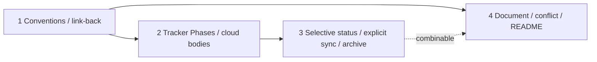

# Linear integration — implementation plan

Phases for [spec.md](./spec.md).

**Status values:** `Not started` · `Started` · `Reviewing` · `Done` · `Deferred` · `Blocked`

## Progress overview

Work-split items 2 and 4’s cloud-ready body are one phase (Tracker Phase description). Document mirror, conflict stop, and operator README are one later phase.

| Phase | Status | Name | Tier | Depends on | Combinable with |
| ----- | ---- | ------ | ---- | ---------- | --------------- |
| **1** | Done | Conventions and create-from link-back | Medium | — | — |
| **2** | Done | Tracker Phases and cloud-ready bodies | High | 1 | — |
| **3** | Done | Selective status updates, explicit sync, archive | High | 2 | 4 |
| **4** | Done | Document mirror, conflict stop, README | Medium | 1 | 3 |



## Phase 1 — Conventions and create-from link-back

**Tracker phase:** n/a

**Goal:** Create-from can link a Linear issue to a new folder without rewriting the issue body, using conventions and a shared sync helper.

**Covers:** G1 (create from linear), G7 (repo canonical), R1 (conventions gate), R2 (no body rewrite), R3 (first link back), R20 (routing entry), R21 (mcp session), R22 (reference gate)

**Read first:**

- [business-logic.md › R1 (conventions gate)](./business-logic.md#r1-conventions-gate)
- [business-logic.md › R2 (no body rewrite)](./business-logic.md#r2-no-body-rewrite)
- [business-logic.md › R3 (first link back)](./business-logic.md#r3-first-link-back)
- [business-logic.md › R20 (routing entry)](./business-logic.md#r20-routing-entry)
- [business-logic.md › R21 (mcp session)](./business-logic.md#r21-mcp-session)
- [business-logic.md › R22 (reference gate)](./business-logic.md#r22-reference-gate)
- [business-logic.md › Create-from and link-back](./business-logic.md#create-from-and-link-back)
- [contracts.md › Linear conventions](./contracts.md#linear-conventions-project-conventions--work-items)
- [contracts.md › Tracker Spec identity](./contracts.md#tracker-spec-identity)
- [contracts.md › Link-back](./contracts.md#link-back)
- [contracts.md › Linear MCP get_issue](./contracts.md#linear-mcp-get_issue)
- [contracts.md › Linear MCP save_issue](./contracts.md#linear-mcp-save_issue)
- [contracts.md › Linear MCP save_comment](./contracts.md#linear-mcp-save-comment)

**Tier:** Medium — first Linear write-back path; MCP ops and field tables are already specified

**Not in this phase:** Tracker Phases; status updates; Document create/regenerate; plugin root README Linear section

**Deliverables:**

- `skills/spec/templates/spec-docs-readme.md` — extend: Work items slots for `Linear project: <id> | n/a`, team, fetch blurb, Tracker Spec/Tracker Phase state maps, optional design label and default `[repo=…]`
- `skills/spec/templates/spec.md` — keep tracker-agnostic `Work item`; add machine fields near it for Tracker Spec URL, Document id, and Document URL (filled after Linear returns them)
- `skills/spec/stages/linear-sync.md` — new, because: shared update doctrine reused by create-spec, plan, implement, and explicit sync (lifecycle boundary)
- `skills/spec/stages/create-spec.md` — extend: after `Work item` is set, call link-back when write-back is allowed; keep existing AC→goal mapping
- `skills/spec/SKILL.md` — extend: Infer table row for `/spec linear sync` (and equivalent create/repair wording) → `stages/linear-sync.md`

**Approach** (advisory):

1. Fill Work items schema in `templates/spec-docs-readme.md` from the contracts field table. Keep live project fill out of this phase (init-project todo).
2. Add `linear-sync.md` with **Preconditions** (R1 (conventions gate), R21 (mcp session), R22 (reference gate)), **Link-back**, and stubs or “later phase” pointers for Tracker Phase, selective Status, Document, Conflict, and Explicit sync so later phases extend one file.
3. Wire create-spec Write: after successful `Work item` set, invoke link-back. On missing MCP/conventions, warn once and still allow `spec.md` write without inventing a team.
4. Link-back: `save_comment` with repo path text; optional `addLabels`; `links` only with a real URI. Write the returned Tracker Spec URL into `spec.md`. Never set Tracker Spec `description` to the spec.
5. Add Infer routing for explicit sync. Its full create/repair behavior lands in phase 3.

Do:

```text
# link-back may touch
save_comment(issueId, body with repo path text)
save_issue(id, addLabels; links only if real URI)
# then write Tracker Spec URL into spec.md
```

Do not:

```text
save_issue(id, description: <full spec.md>)
save_issue(id, links: [{url: "spec_docs/foo/"}])
```

### Acceptance scenarios

- **A1.1 — Create-from sets Work item and link-back**
  - Journey: Create a spec from a Linear issue, steps 1–3
  - Given Linear MCP works and Work items conventions are filled
  - When the user creates a spec from `TEAM-123`
  - Then `spec.md` has `Work item` set and the Tracker Spec URL stored, Linear gets a comment naming the repo path, no fake `links` URI is invented, and the issue description is unchanged

- **A1.2 — Missing conventions stops write-back only**
  - Journey: Create a spec from a Linear issue, Goes wrong (MCP or conventions missing)
  - Given the folder would be linked, and Work items conventions are still the placeholder, or Linear MCP is missing
  - When create-from would write back
  - Then the skill warns once, skips write-back, and does not invent a team or half-link

- **A1.3 — Explicit sync route exists**
  - Journey: —
  - Given the skill Infer table
  - When the user says `/spec linear sync` (or equivalent create/repair wording)
  - Then the skill opens `stages/linear-sync.md` rather than inventing a second doctrine

### Done when

- [x] Tier verify passes (Project conventions in `spec_docs/README.md`)
- [x] A1.1–A1.3 pass
- [x] Create-spec still maps Linear AC onto goals’ `Source:` lines and does not paste the raw payload into `spec.md`
- [x] Tracker Spec URL is written into `spec.md` only after Linear returns it; no bare-path `links`
- [x] No HTML author comments or `{{…}}` left in touched skill/template files

### Close-out

- Verified:
  - Low: Diffed deliverables against Done when / A1.1–A1.3; no HTML author comments in new/edited skill prose; templates keep intentional `{{…}}` fill-ins.
  - Medium: `rg -F` for R1 (conventions gate), R2 (no body rewrite), R3 (first link back), R20 (routing entry), R21 (mcp session), R22 (reference gate), G1 (create from linear), G7 (repo canonical) — each present in the named stage/skill where it lands. Outcomes: all matched.
  - A1.1: create-spec sets Work item, calls linear-sync Link-back (comment path, URL after return, no bare-path links, no description rewrite).
  - A1.2: missing MCP/conventions → warn once, skip write-back only, no invent team/half-link; `spec.md` write still allowed.
  - A1.3: Infer row `/spec linear sync` → `stages/linear-sync.md`.
- Deviations: None.
- Follow-ups: Full explicit-sync create/repair (phase 3); Tracker Phase / Document / Conflict stubs remain pointers until phases 2–4; live Project conventions fill stays init-project.

## Phase 2 — Tracker Phases and cloud-ready bodies

**Tracker phase:** n/a

**Goal:** After a plan exists, the skill creates or updates one Tracker Phase per dispatch unit with brief-quality text and stores its id in the plan; planless folders have no Tracker Phases.

**Covers:** G2 (tracker phases), G4 (cloud ready phases), G6 (thin noop), R4 (freeze before plan), R5 (thin noop), R6 (repo-stored phase identity), R7 (unreferenced leave), R8 (direct and selective update), R9 (cancel removed), R10 (flat phases), R15 (cloud ready body), R16 (human gated launch), R22 (reference gate)

**Read first:**

- [business-logic.md › R4 (freeze before plan)](./business-logic.md#r4-freeze-before-plan)
- [business-logic.md › R5 (thin noop)](./business-logic.md#r5-thin-noop)
- [business-logic.md › R6 (repo-stored phase identity)](./business-logic.md#r6-repo-stored-phase-identity)
- [business-logic.md › R7 (unreferenced leave)](./business-logic.md#r7-unreferenced-leave)
- [business-logic.md › R8 (direct and selective update)](./business-logic.md#r8-direct-and-selective-update)
- [business-logic.md › R9 (cancel removed)](./business-logic.md#r9-cancel-removed)
- [business-logic.md › R10 (flat phases)](./business-logic.md#r10-flat-phases)
- [business-logic.md › R15 (cloud ready body)](./business-logic.md#r15-cloud-ready-body)
- [business-logic.md › R16 (human gated launch)](./business-logic.md#r16-human-gated-launch)
- [business-logic.md › R22 (reference gate)](./business-logic.md#r22-reference-gate)
- [business-logic.md › Tracker Phase create and update](./business-logic.md#tracker-phase-create-and-update)
- [contracts.md › Tracker Spec identity](./contracts.md#tracker-spec-identity)
- [contracts.md › Tracker Phase identity](./contracts.md#tracker-phase-identity)
- [contracts.md › Tracker Phase body](./contracts.md#tracker-phase-body-cloud-ready)
- [contracts.md › Create or update Tracker Phase](./contracts.md#create-or-update-tracker-phase)
- [contracts.md › Native Cursor assign / @Cursor](./contracts.md#native-cursor-assign--cursor)

**Tier:** High — persisted identity and ownership rules interact; Tracker Phase body is a contract other agents rely on

**Not in this phase:** Tracker Spec/Tracker Phase status updates; progress comments; Document mirror; conflict stop; full explicit-sync repair behavior

**Deliverables:**

- `skills/spec/templates/implementation-plan.md` — add `Tracker phase: n/a` to every phase packet
- `skills/spec/stages/linear-sync.md` — extend: create/update/cancel by repo-stored id; Tracker Phase body builder aligned with implement Phase brief
- `skills/spec/stages/plan.md` — extend: after plan write or dispatch-unit change, create only missing Tracker Phases when linked and conventions allow; preserve ids through renames/renumbering
- `skills/spec/stages/implement.md` — extend: note that Tracker Phase bodies reuse Phase brief / Env checklist fields; fallback create at or just before first implement when a phase still says `n/a`

**Approach** (advisory):

1. Routine hooks skip Tracker Phase writes when `Work item` is `n/a` (R22 (reference gate)). Explicit sync may create the Tracker Spec first. If MCP is missing, warn once and skip.
2. Build dispatch units from the plan overview: one unit per phase, or one unit for a combinable group.
3. Ensure each phase has `Tracker phase: <id> | n/a`. For a combinable group, every phase stores the same value.
4. If the value is `n/a`, create one Tracker Phase with Linear API `parentId` = Tracker Spec id, then persist the returned id on every phase in that unit. Otherwise update directly by id.
5. Leave Linear work not referenced in the repo untouched. When removing a referenced unit, cancel + comment before deleting its field; never silent-delete.
6. Body: canon banner, unit identity, Done when summary, paths / Read first cues, stop-after-this-unit, env cues, optional `[repo=…]` from conventions.
7. Do not auto-assign Cursor. Skill may mention “mark Tracker Phase ready to delegate” as status/label only.

### Acceptance scenarios

- **A2.1 — Plan creates Tracker Phases and stores ids**
  - Journey: Plan phases appear as Tracker Phases, steps 1–2
  - Given a linked folder with a new `implementation-plan.md` and write-back allowed
  - When plan creation runs
  - Then one Tracker Phase exists per dispatch unit with a brief-quality body, and each phase stores its returned id

- **A2.2 — Thin / planless is a no-op for Tracker Phases**
  - Journey: Plan phases appear as Tracker Phases, step 4
  - Given a linked folder with no `implementation-plan.md`
  - When structure sync runs
  - Then no Tracker Phases are created

- **A2.3 — Stored ids update directly; unreferenced work is left alone**
  - Journey: Plan phases appear as Tracker Phases, Goes wrong (duplicates / human work)
  - Given Tracker Phase ids already exist and unrelated Linear work is present
  - When a source field changes
  - Then only the referenced Tracker Phase updates in place, with no duplicate, and unrelated work is unchanged

- **A2.4 — Removed unit cancels with comment**
  - Journey: —
  - Given a Tracker Phase id for a unit being removed from the plan
  - When the plan edit is applied
  - Then that Tracker Phase is canceled with a reason comment before its repo reference is removed

- **A2.5 — Tracker Phase body forbids inventing scope**
  - Journey: Start cloud work from Linear, Goes wrong (stale Linear AC)
  - Given a refreshed Tracker Phase
  - When an agent reads its description
  - Then the body states the repo is canonical and Done when bounds scope; no skill Cloud Agent launcher is introduced

- **A2.6 — Routine hook does not create implicitly**
  - Journey: —
  - Given a folder with `Work item: n/a`
  - When an unrelated plan or phase hook runs
  - Then no Linear writes run and no Tracker Phases are created; explicit `/spec linear sync` remains available to create them

- **A2.7 — Linked but MCP missing warns**
  - Journey: —
  - Given a linked folder and Linear MCP unavailable
  - When a Tracker Phase create/update would run
  - Then the skill warns once and skips write-back

- **A2.8 — Combined phases share one id**
  - Journey: Plan phases appear as Tracker Phases
  - Given phases 2 and 3 are one combinable dispatch unit
  - When their Tracker Phase is created
  - Then both phase sections store the same returned Tracker Phase id

### Done when

- [x] Tier verify passes (Project conventions in `spec_docs/README.md`)
- [x] A2.1–A2.8 pass
- [x] Tracker Phase body field list stays aligned with `stages/implement.md` › Phase brief / Env checklist
- [x] Tracker Phases are never created while `implementation-plan.md` is missing
- [x] Unlinked folders never call Linear discovery

### Close-out

- Verified:
  - High deciding factor (repo-stored Tracker Phase id is identity): create writes returned id immediately; update/cancel address that id only; never title-search or `list_issues` rediscovery; combinable unit shares one id on every phase; cancel+comment before removing the field; routine hooks skip when `Work item: n/a`.
  - Low: Diffed deliverables against Done when / A2.1–A2.8; stages have no leftover HTML author comments; template keeps intentional `{{…}}` / HTML comments and adds `Tracker phase: n/a`.
  - Medium: `rg -F` for R4–R10, R15, R16, R22, G2, G4, G6 — each present in the named stage/template where it lands. Outcomes: all matched.
  - High dry-read: `linear-sync` ordered Guards (unlinked → no plan → MCP) before Create/Update/Cancel; plan hook and implement fallback both require Guards path via linear-sync; Create cannot run without plan file + linked Work item; Cancel steps require comment then cancel then field remove.
  - A2.1: plan after-write hook creates missing Tracker Phases, stores returned ids, body from brief fields.
  - A2.2: no plan file → Tracker Phase no-op (R5); plan exists = `<slug>.plan.md` or bare `implementation-plan.md`.
  - A2.3: update by stored id only; unreferenced leave; no duplicate on rename/renumber.
  - A2.4: cancel + reason comment before removing repo field.
  - A2.5: canon banner + Done when bounds; MUST NOT skill Cloud Agent launcher / invent scope.
  - A2.6: `Work item: n/a` → skip routine Tracker Phase writes; no Linear discovery.
  - A2.7: missing MCP/conventions → warn once, skip write-back.
  - A2.8: combinable group → same `Tracker phase:` id on every phase in the unit.
  - Body table in linear-sync cites implement Phase brief / Env checklist; implement notes mutual alignment.
  - Unlinked folders: Guards + plan/implement hooks forbid discovery when Work item is n/a.
- Deviations: None.
- Follow-ups: Status selective update + progress comments + full explicit-sync create/repair (phase 3); Document mirror / conflict / README (phase 4); live Project conventions fill stays init-project.

## Phase 3 — Selective status updates, explicit sync, and archive gate

**Tracker phase:** n/a

**Goal:** Tracker Spec and Tracker Phase states follow repo Progress and plan status through selective updates; explicit sync creates or repairs missing references; archive respects referenced Tracker Phase completion.

**Covers:** G3 (status mirror), R8 (direct and selective update), R11 (status mirror), R12 (selective tracker writes), R13 (progress log), R18 (archive gate)

**Read first:**

- [business-logic.md › R11 (status mirror)](./business-logic.md#r11-status-mirror)
- [business-logic.md › R12 (selective tracker writes)](./business-logic.md#r12-selective-tracker-writes)
- [business-logic.md › R13 (progress log)](./business-logic.md#r13-progress-log)
- [business-logic.md › R18 (archive gate)](./business-logic.md#r18-archive-gate)
- [business-logic.md › Selective status update and progress log](./business-logic.md#selective-status-update-and-progress-log)
- [business-logic.md › Archive gate](./business-logic.md#archive-gate)
- [business-logic.md › States and transitions](./business-logic.md#states-and-transitions)
- [contracts.md › Progress-log marker](./contracts.md#progress-log-marker)
- [contracts.md › Selective status update](./contracts.md#selective-status-update)
- [contracts.md › Explicit sync](./contracts.md#explicit-sync)

**Tier:** High — lifecycle across gates; append-only timeline; archive incomplete-board ask

**Not in this phase:** Document regenerate; Tracker Phase create rules already shipped in phase 2; plugin README

**Deliverables:**

- `skills/spec/stages/linear-sync.md` — extend: selective status update, progress-log comments, and explicit sync (create `n/a`, update referenced ids, repair invalid references, ask for missing information)
- `skills/spec/stages/implement.md` — extend: on a phase status change, update only that Tracker Phase; on archive, apply the gate before Tracker Spec Done
- `skills/spec/stages/plan.md` — extend: on a Progress/gate change, update only the Tracker Spec

**Approach** (advisory):

1. Map `Progress` → Tracker Spec state/labels and phase status → Tracker Phase state via conventions maps. Linear never writes the plan.
2. On a gate change, update only the Tracker Spec. On a phase-status change, update only the referenced Tracker Phase. On a real delta, `save_comment` a **new** Tracker Spec comment with `<!-- spec-sync-progress: slug=… -->`.
3. `/spec linear sync` is the explicit create/repair path. It processes repo fields, asks for missing information, and never becomes a prerequisite for routine selective writes.
4. Archive: Tracker Spec Done only when every referenced Tracker Phase is Done or Deferred; otherwise ask.

### Acceptance scenarios

- **A3.1 — Phase status selectively mirrors to Tracker Phase**
  - Journey: Status stays aligned during implement, steps 1–2
  - Given a linked plan with Tracker Phase ids and conventions maps filled
  - When a phase moves `Started` / `Reviewing` / `Done` / `Blocked`
  - Then only that Tracker Phase state updates, without a confirm prompt or full sync

- **A3.2 — Progress comment on real change only**
  - Journey: Status stays aligned during implement, step 2
  - Given a real Progress or Tracker Phase status change
  - When its selective update runs
  - Then a new Tracker Spec progress comment is posted; a repeated no-op update posts none

- **A3.3 — Linear does not drive the plan**
  - Journey: Status stays aligned during implement, Goes wrong (Linear as driver)
  - Given someone changes a Tracker Phase state in Linear
  - When the skill runs
  - Then plan phase status and `Progress` are not overwritten from Linear

- **A3.4 — Explicit sync creates and repairs**
  - Journey: —
  - Given a `Tracker phase: n/a`, an invalid stored id, or missing required conventions
  - When the user runs `/spec linear sync`
  - Then the skill creates missing tracker work, updates referenced ids, or asks for the missing information; it does not infer ownership from titles

- **A3.5 — Archive gate**
  - Journey: Status stays aligned during implement, End state / archive
  - Given archive is confirmed but a referenced Tracker Phase is still open
  - When the skill would mark the Tracker Spec Done
  - Then it asks instead of silently completing the Tracker Spec

### Done when

- [x] Tier verify passes (Project conventions in `spec_docs/README.md`)
- [x] A3.1–A3.5 pass
- [x] No per-Done Linear confirm prompt remains in implement status hooks
- [x] Progress comments are append-only (no edit-in-place path)

### Close-out

- Verified:
  - High deciding factor (selective updates only): gate/Progress → Tracker Spec only; phase status → that Tracker Phase only; append-only progress comments on real deltas; Explicit sync is create/repair and never a routine prerequisite; archive asks before Tracker Spec Done if any referenced Tracker Phase is still open.
  - Low: Diffed deliverables against Done when / A3.1–A3.5; only intentional progress-marker HTML in linear-sync; no leftover author comments or fill-in placeholders in touched stages.
  - Medium: `rg -F` for R8 (direct and selective update), R11 (status mirror), R12 (selective tracker writes), R13 (progress log), R18 (archive gate), G3 (status mirror), G7 (repo canonical) — each present in the named stage where it lands. Outcomes: all matched (R8 in linear-sync + plan; implement cites selective Status path).
  - High dry-read: Status Guards (unlinked/`n/a` → MCP/maps → selective-only) before Progress → Tracker Spec, Phase status → Tracker Phase, Progress-log, Archive gate; Explicit sync is a separate entry that reuses Tracker Phase Create and is forbidden as a routine side effect; implement/plan hooks call Status only.
  - A3.1: implement status hook updates only that Tracker Phase; MUST NOT per-Done Linear confirm; MUST NOT full sync.
  - A3.2: real delta → new `save_comment` with `<!-- spec-sync-progress: slug=… -->`; no-op → none; never edit prior progress comments.
  - A3.3: Linear never writes plan status or Progress (linear-sync + implement + plan).
  - A3.4: Explicit sync creates `n/a`, updates referenced, repairs invalid, asks for missing project/team/maps/ownership; no title-search / `list_issues` ownership guess; reuses phase-2 Create path.
  - A3.5: archive gate asks when a referenced Tracker Phase is still open; no silent Tracker Spec Done.
  - SKILL Infer already routes `/spec linear sync` → linear-sync (no extra pointer needed).
- Deviations: None.
- Follow-ups: Document mirror / conflict / plugin README (phase 4); tech-specs `Progress: tech` selective Tracker Spec hook not in this phase’s deliverables (plan + implement cover plan/implementing/archive); live Project conventions fill stays init-project.

## Phase 4 — Document mirror, conflict policy, and operator README

**Tracker phase:** n/a

**Goal:** Linear-only readers get a regenerable Document mirror; banners forbid Linear edits; operators know local MCP sync vs `@Cursor` kickoff.

**Covers:** G5 (document mirror), R14 (conflict stop), R17 (document mirror), R19 (no secrets), R21 (mcp session), R22 (reference gate)

**Read first:**

- [business-logic.md › R14 (conflict stop)](./business-logic.md#r14-conflict-stop)
- [business-logic.md › R17 (document mirror)](./business-logic.md#r17-document-mirror)
- [business-logic.md › R19 (no secrets)](./business-logic.md#r19-no-secrets)
- [business-logic.md › Conflict stop before mirror overwrite](./business-logic.md#conflict-stop-before-mirror-overwrite)
- [contracts.md › Document mirror content](./contracts.md#document-mirror-content)
- [contracts.md › Tracker Spec identity](./contracts.md#tracker-spec-identity)
- [contracts.md › Linear MCP save_document / get_document](./contracts.md#linear-mcp-save_document--get_document)
- [spec.md › Notes › Plugin README](./spec.md#notes)
- [spec.md › D15 (document trigger)](./spec.md#d15-document-trigger--create-document-on-first-link-regenerate-when-tldr-or-goals-change)
- [spec.md › D16 (no linear edits)](./spec.md#d16-no-linear-edits--do-not-change-binding-content-in-linear-skip-non-trivial-compare)
- [spec.md › D20 (conflict choices)](./spec.md#d20-conflict-choices--regular-options-when-a-linear-prose-conflict-is-known)
- [spec.md › Q1 (auto detect)](./spec.md#q1-auto-detect--should-v1-add-any-automatic-linear-body-edit-detection)
- [spec.md › D19 (mcp session)](./spec.md#d19-mcp-session--tracker-write-back-only-in-sessions-with-working-linear-mcp)

**Tier:** Medium — Document create/regenerate and banners; README is mechanical once the operator model is fixed

**Not in this phase:** Tracker Phase structure rules; status maps; inventing a skill Cloud Agent launcher; filling adopter Project conventions (init-project); non-trivial conflict fingerprinting (D16 (no linear edits))

**Deliverables:**

- `skills/spec/stages/linear-sync.md` — extend: Document create on first link, regenerate when TL;DR or goals change; persist Document id + URL in `spec.md`; conflict check offers D20 (conflict choices) when a conflict is known (no required hash tripwire)
- `skills/spec/stages/create-spec.md` — extend: first-link path also creates Document when write-back allowed (D15 (document trigger))
- `README.md` — extend: Linear (or Work items) operator section — connect Linear MCP in IDE; fill conventions; create-from/sync locally; native `@Cursor` for cloud; do not expect cloud alone to sync Linear; do not edit Linear as binding AC; optional note on cloud Linear MCP OAuth

**Approach** (advisory):

1. On first successful link: create Document (TL;DR + goals/AC summary + “do not edit in Linear” banner); store Document id and URL in `spec.md`.
2. Regenerate Document from the repo when TL;DR or goals change; not on status-only ticks. Never pull Linear prose into `spec.md`.
3. If a conflict is known, warn and offer D20 (conflict choices). Do not add a hash tripwire unless Q1 (auto detect) lands something trivial.
4. Plugin README documents local MCP write-back vs Linear product kickoff (D19 (mcp session)) and the no-edit-in-Linear rule (D16 (no linear edits)).

### Acceptance scenarios

- **A4.1 — Document created on first link**
  - Journey: Create a spec from a Linear issue, step 4; Linear-only review of design, steps 1–2
  - Given write-back allowed on first link
  - When link-back completes
  - Then a Linear Document exists on the Tracker Spec with mirror banner, TL;DR, and goals/AC summary, and its id and URL are stored in `spec.md`

- **A4.2 — Regenerate on summary change, not status-only**
  - Journey: Linear-only review of design, step 3
  - Given Document id is stored and TL;DR or goals changed in the repo
  - When sync runs after that change versus after a status-only change
  - Then Document content refreshes for the summary change and does not regenerate for status-only

- **A4.3 — Banner forbids Linear edits; known conflict uses choices**
  - Journey: Linear-only review of design, Goes wrong (edit as AC truth)
  - Given a Document mirror on a linked Tracker Spec
  - When an operator reads the Document or a known conflict is raised
  - Then the banner states do not edit binding content in Linear, and a known conflict offers D20 (conflict choices) without a required hash tripwire

- **A4.4 — Operator README states kickoff ≠ sync**
  - Journey: Start cloud work from Linear, Goes wrong (expect cloud alone to sync)
  - Given the plugin root `README.md`
  - When an operator reads the Linear section
  - Then it states local IDE + Linear MCP for write-back, native `@Cursor` for kickoff, and that cloud alone must not be assumed to sync Linear

### Done when

- [x] Tier verify passes (Project conventions in `spec_docs/README.md`)
- [x] A4.1–A4.4 pass
- [x] Document, Tracker Phase, and comment payloads stay summaries — no secrets or full private dumps
- [x] Missing Linear MCP still warns/skips write-back without failing an implement unit solely for sync
- [x] No body-hash fingerprint field is required in `spec.md`

### Close-out

- Verified:
  - Low: Diffed `linear-sync.md` Document/Conflict, create-spec Link-back → Document, plugin `README.md` Linear section against Done when / A4.1–A4.4; no HTML author comments in touched skill prose.
  - Medium: `rg -F` for R14 (conflict stop), R17 (document mirror), R19 (no secrets), R21 (mcp session), R22 (reference gate), G5 (document mirror), D15 (document trigger), D16 (no linear edits), D19 (mcp session), D20 (conflict choices) — present in landing files.
  - A4.1: Link-back then Document create; persist Document id/URL after Linear returns.
  - A4.2: Regenerate on TL;DR/goals change only; status-only skips Document.
  - A4.3: Mirror banner + D20 (conflict choices); no required body-hash.
  - A4.4: README states local MCP write-back vs `@Cursor` kickoff; cloud alone must not be assumed to sync.
  - R19 (no secrets): Document content is summary-only; create-spec MUST NOT paste full spec/secrets.
  - Missing MCP: warn/skip; create-spec must not fail solely for sync.
- Deviations: None.
- Follow-ups: Live Project conventions fill stays init-project; Q1 (auto detect) remains open (policy-only conflict surface).

## Risks

- **Cloud checkout status lag.** Plan status on a cloud agent checkout may not match Linear until merge and a later MCP-capable sync. Mitigation: implement/status copy notes catch-up; do not treat Linear as ahead of the repo.
- **Adopter conventions empty.** Until init-project or a human fills Work items, write-back stays warn-and-skip on linked folders. Mitigation: schema lands in the template in phase 1; do not invent team maps in skill code.
