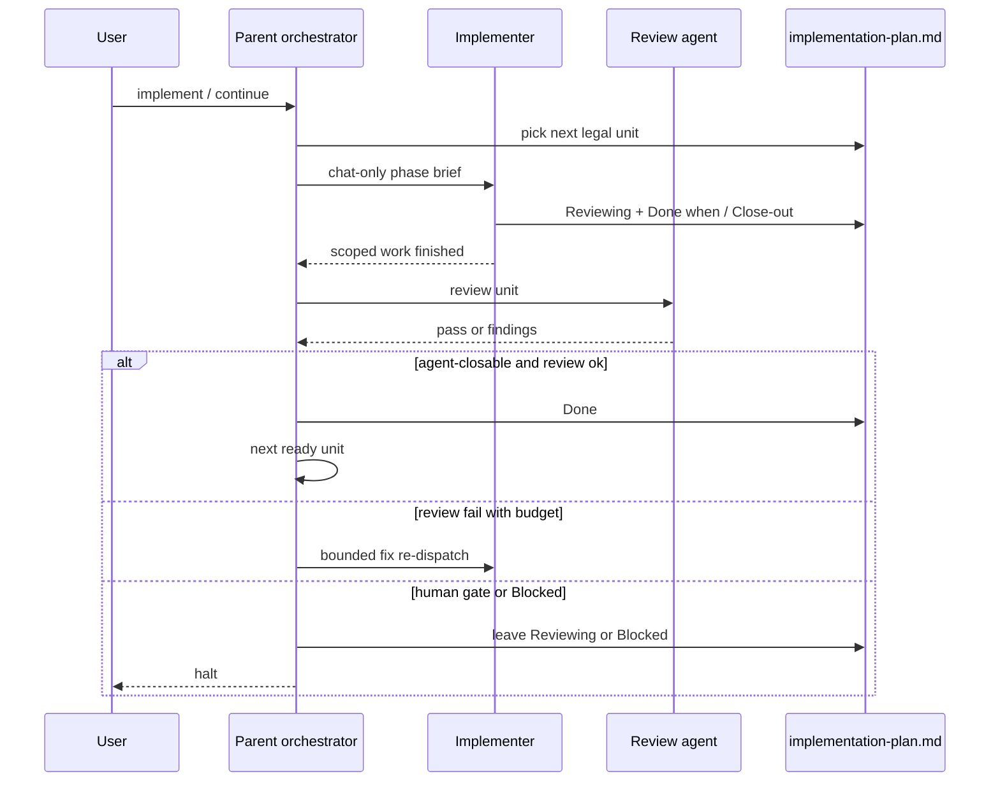

# Serial subagent implement — business logic

> Created because: orchestrator has multi-step workflows, stop/resume, and more than five binding rules.

Rules for **multi-subagent**. [spec.md](./spec.md) owns scope, non-goals, glossary, and decisions; cite them in full form (`see D1 (serial default)`).

## TL;DR

- Multi-phase implement is serial SDD: one fresh implementer per dispatch unit, then one required review agent.
- The runner auto-continues agent-closable units and halts on human gates.
- One-phase plans stay in the parent; parallel and surprise SCM stay forbidden.

## Rules

### R1 (serial default)

**Lands in:** `skills/spec/SKILL.md` › Read only / Bounds; `skills/spec/stages/implement.md` › Phase selection / new Serial SDD section

- When the plan has more than one dispatch unit left, `/spec implement` or continue MUST run serial subagent-driven development by default (see D1 (serial default), G1 (serial implementers)).
- The parent MUST NOT keep implementing the next unit in the same bloated session when serial SDD applies.
- Parallel implementers MUST NOT run.

> **Preserve:** Prefer one active spec at a time. Bounds no-surprise-SCM unless asked (G6 (scm consent)).

### R2 (one active unit)

**Lands in:** `skills/spec/stages/implement.md` › Phase status

- Only one dispatch unit MAY be `Started`, `Reviewing`, or `Blocked` at a time.
- A unit MAY start only when every phase in its **Depends on** cell is `Done` or `Deferred`.
- **Combinable with** means one dispatch unit and one brief, not parallel writers (see D2 (combinable meaning), D3 (unit of dispatch)).

> **Preserve:** Today's progress-overview order gate and status vocabulary.

### R3 (fresh context)

**Lands in:** `skills/spec/stages/implement.md` › new Serial SDD section; `skills/spec/SKILL.md` (replace blanket ban)

- For each new dispatch unit under serial SDD, the parent MUST dispatch a fresh implementer context by default (see D5 (fresh context exceptions)).
- Soft escapes MUST stay rare: work inside an already-started unit; user continuing after a short clarification; research-only turns.
- Soft escapes MUST NOT become a second default mode.

### R4 (parent path)

**Lands in:** `skills/spec/stages/implement.md` › Phase selection

- When the plan is one phase, or already one combinable unit, the parent MUST implement in the current session (or one cloud paste).
- Serial multi-agent orchestration MUST NOT be required for that case (G1 (serial implementers)).

### R5 (phase brief)

**Lands in:** `skills/spec/stages/implement.md` › new Phase brief; field shape in [contracts.md](./contracts.md)

- Before dispatch, the parent MUST give the implementer a phase brief that covers at least the fields in contracts (G2 (phase brief), D7 (brief medium)).
- The brief MUST be a chat-only payload (or paste text for cloud). The parent MUST NOT write a durable brief file.
- The implementer MUST NOT be required to read the full plan or unrelated phases.
- For cloud runs, the parent MUST also supply the env checklist from contracts (G7 (cloud ready brief)).

### R6 (worker writeback)

**Lands in:** `skills/spec/stages/implement.md` › Session checklist / Phase status

- The implementer worker MUST update `implementation-plan.md` on its checkout: Done-when checkboxes, **Close-out**, and status to `Reviewing` after verify (G5 (status writeback), D9 (done timing)).
- The worker MUST NOT mark `Done`. Parent marks `Done` only after the review agent passes and the unit is agent-closable.
- Report-only to the parent (no plan edit) MUST NOT count as done.

### R7 (required review)

**Lands in:** `skills/spec/stages/implement.md` › new Review gate

- After the worker marks `Reviewing`, the parent MUST run exactly one review subagent before `Done` or escalate (G3 (review agent), D4 (required single reviewer), D9 (done timing)).
- The review MUST check spec compliance and code quality for that unit only.
- On fail, the parent MUST re-dispatch the implementer for a bounded fix loop. If the budget is exhausted and findings remain, the parent MUST mark `Blocked` with findings in Close-out / Follow-ups and wait for continue (D8 (review fail)).
- After agent review passes, human sign-off (when still required) keeps `Reviewing` and halts the runner; that halt is the human gate, not a second agent.
- A dual-reviewer loop (two review agents) MUST NOT be required in v1.

### R8 (stop resume)

**Lands in:** `skills/spec/stages/implement.md` › Phase status / new Stop and resume

- The runner MUST continue automatically across agent-closable units without asking "should I continue?"
- It MUST NOT halt solely because the worker set `Reviewing` for the agent review gate. It MUST stop when human sign-off is still required after agent review pass, or when an Ask-before item only a person can answer, or when the unit is `Blocked` after a failed fix loop (G4 (stop resume), D8 (review fail), D9 (done timing)).
- Resume MUST use the same `/spec implement` / continue entry: finish the open unit first, then pick the next ready unit.
- The controller MUST NOT invent rulings that replace Ask-before for security or irreversible ops.

### R9 (scm consent)

**Lands in:** `skills/spec/SKILL.md` › Bounds; `skills/spec/stages/implement.md` › Ask before

- Chat consent is enough for cloud, implementation branch, or worktree. No project-level opt-in in `spec_docs/README.md` (G6 (scm consent)).
- When the run already is a Cursor Cloud Agent, cloud consent is implied. Extra branches, worktrees, or commits still need an ask unless the cloud runner's normal branch story applies.
- Asking for an implementation branch MUST NOT imply a worktree, and the reverse MUST NOT hold.
- Default serial SDD MUST use the shared checkout.

### R10 (subagent policy)

**Lands in:** `skills/spec/SKILL.md` › Read only what this turn needs

- The blanket "Do not spawn subagents" line MUST be replaced with an implement-only exception for serial SDD under this spec.
- Subagents for other skill stages (create, promote, audit) MUST remain forbidden unless a later spec says otherwise.

## Actors and entry points

| Entry point | User action | System response | Handled by |
| ----------- | ----------- | --------------- | ---------- |
| Multi-phase implement | `/spec implement` or continue | Serial orchestrator for next legal unit | `stages/implement.md` › Serial SDD |
| Resume human gate | implement / continue after sign-off | Finish open unit, then next ready | `stages/implement.md` › Stop and resume |
| One-phase / single unit | implement | Parent session; no serial orchestration | `stages/implement.md` › Phase selection |
| Cloud opt-in | "use a cloud agent" (or already in cloud) | Same brief + env checklist; one unit | `stages/implement.md` › Phase brief |

## Workflows

### Multi-phase serial implement

1. Parent selects the next legal dispatch unit from the progress overview — `stages/implement.md` › Phase selection.
2. Parent builds the chat-only phase brief (and env checklist when cloud) — R5 (phase brief).
3. Parent dispatches one fresh implementer — R1 (serial default), R3 (fresh context).
4. Worker implements, verifies, updates Close-out / Done when, and marks `Reviewing` — R6 (worker writeback).
5. Parent runs the required review subagent — R7 (required review).
6. On agent-closable pass, parent marks `Done` and continues to the next ready unit — R8 (stop resume), D9 (done timing).
7. On review fail: bounded fix loop; if still failing, mark `Blocked` — D8 (review fail). On human gate after pass, leave `Reviewing` and halt — R8 (stop resume).

### Resume after human review

1. User says implement / continue with a unit in `Reviewing` or person-blocked.
2. Parent continues that same unit first — R2 (one active unit), R8 (stop resume).
3. After close, serial SDD resumes as in the multi-phase workflow.

### One-phase or single combinable unit

1. Parent detects a single dispatch unit left (or the whole plan is one unit).
2. Parent implements in-session (or one cloud paste) — R4 (parent path).
3. Status and Close-out update as today; no serial orchestrator ceremony.

### Optional cloud unit

1. User asks for cloud, or the run already is cloud — R9 (scm consent).
2. Parent or human uses phase brief plus env checklist — R5 (phase brief), G7 (cloud ready brief).
3. Cloud worker updates the plan on its checkout for that unit only — R6 (worker writeback).
4. Runner does not start the next unit until this one is Done (or stops at `Reviewing`).

## States and transitions

Runner and phase status for one dispatch unit:

| From | Event | Guard | To | Side effect |
| ---- | ----- | ----- | -- | ----------- |
| Not started | Parent selects unit | Depends on satisfied; no other active unit | Started | Chat-only brief; implementer dispatched (or parent path) |
| Started | Worker finishes verify | — | Reviewing | Close-out / checkboxes updated; agent review pending |
| Reviewing | Agent review passes; agent-closable | Verify + Done when allow Done | Done | Parent marks Done; may start next unit |
| Reviewing | Agent review passes; needs human | Manual QA / sign-off required | Reviewing | Runner halts |
| Reviewing | Agent review fails; fix budget left | — | Started | Re-dispatch implementer for bounded fix (D8 (review fail)) |
| Reviewing | Agent review fails; budget exhausted | — | Blocked | Findings in Close-out / Follow-ups; runner halts |
| Started | Person Ask-before | Only a person can answer | Blocked | Runner halts; reason recorded |
| Reviewing | Human sign-off + continue | Same unit | Done or Started | Resume; then next ready unit |
| Blocked | Person answers + continue | Same unit | Started | Resume serial path |
| Any active | Parallel dispatch attempt | — | (rejected) | MUST NOT start second implementer |

## Conditions and error cases

| Rule | Condition | Behaviour | Handled by | User message |
| ---- | --------- | --------- | ---------- | ------------ |
| R2 (one active unit) | Upstream Depends on open | Stop; report blocker | Phase selection | Name the blocker phase |
| R2 (one active unit) | Second unit would go active | Reject | Serial SDD | — |
| R1 (serial default) | Parallel implementers requested | Reject | Serial SDD | Serial only; parallel out of scope |
| R4 (parent path) | Single dispatch unit | Parent implements | Phase selection | Name phase and tier as today |
| R8 (stop resume) | Reviewing remains after agent pass; human needed | Halt runner | Stop and resume | Waiting on human review |
| R8 (stop resume) | Person Ask-before hit | Halt; do not invent ruling | Ask before | Name the ask |
| R9 (scm consent) | Branch / worktree / commit without ask | Refuse | Bounds / Ask before | Ask first |
| R6 (worker writeback) | Worker reports only in chat | Reject as incomplete | Session checklist | Plan must be updated |
| R6 (worker writeback) | Worker marks Done before review | Reject; require Reviewing | Session checklist | Review gate first |
| R7 (required review) | Review finds problems; budget left | Re-dispatch implementer | Review gate | — |
| R7 (required review) | Review fails; budget exhausted | Mark Blocked with findings | Review gate | Waiting on continue |

## Interactions with existing domain

- **Progress overview** (`skills/spec/templates/implementation-plan.md`): Source of truth for what may start next. Orchestrator reads status, **Depends on**, and **Combinable with** only.
- **Phase packet** (same template): Goal, **Read first**, deliverables, Done when, tier, Ask-before, and Close-out feed the brief. Brief fields are owned by [contracts.md](./contracts.md).
- **Phase tier** (`skills/spec/design-quality.md`): Still selects model / effort for the implementer. A combinable group uses the highest member tier.
- **No-surprise SCM** (adapt-superpowers R9 / this skill Bounds): Kept; G6 (scm consent) only adds named consent for cloud, branch, and worktree.
- **Subagent ban** (`skills/spec/SKILL.md`): Replaced by R10 (subagent policy) for implement serial SDD only.
