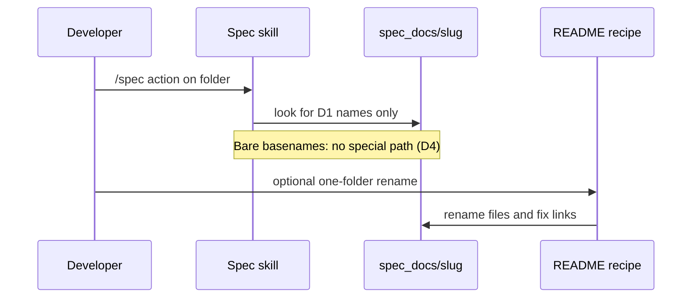

# Slug-prefixed spec doc filenames — business logic

> Created because: Filename map, stage resolution, and migration rules need a single binding home beyond D1 (role map).

Rules for **slug-prefixed-docs**. [spec.md](./spec.md) owns scope, non-goals, glossary, and decisions; cite them in full form (`see D1 (role map)`).

## TL;DR

- **Emit and resolve** only the slug-prefixed map for new work; never dual-write or auto-rename.
- **Plan status** stays in the `<slug>.plan.md` body; Cursor todos are out of scope.
- **Old folders** keep bare basenames until a person follows the documented recipe; `/spec` does nothing special if they are still bare (D4 (nothing on bare)).

## Rules

### R1 (filename pattern)

**Lands in:** `skills/spec/SKILL.md` › Progress / Spec docs / Infer table; `skills/spec/templates/spec.md` › Doc index

- Every durable sibling the skill creates under `spec_docs/<slug>/` MUST match D1 (role map): `<slug>.spec.md`, `<slug>.logic.md`, `<slug>.contracts.md`, `<slug>.ui.md`, `<slug>.plan.md`, or `<slug>.data.md` only when that folder already used `data.md`.
- The folder path MUST stay `spec_docs/<slug>/` (and `archive/<slug>/` when archived).
- Relative links inside a folder MUST use those filenames.

> **Preserve:** Progress gate meanings and ID schemes (`G`, `R`, `D`, `Q`, `A`) stay as today.

### R2 (short roles only)

**Lands in:** `skills/spec/SKILL.md` › Spec docs; templates that cite tech-doc or plan paths

- New work MUST NOT emit `business-logic.md` or `implementation-plan.md` as sibling basenames.
- The business-rules role MUST be the short name `logic` in the filename (`<slug>.logic.md`).
- The plan role MUST be `plan` with the `.plan.md` extension (`<slug>.plan.md`), not `<slug>.implementation-plan.md`.

### R3 (new names only)

**Lands in:** `skills/spec/stages/create-spec.md`, `tech-specs.md`, `plan.md`, `implement.md`, `audit.md` › path citations throughout

- Create, promote, plan, implement, archive, and audit MUST create, read, and update only the D1 (role map) names for new work (see G4 (skill resolves)).
- The skill MUST NOT write both old and new basenames for the same sibling.
- The skill MUST NOT dual-read old and new basenames as a compatibility layer (non-goal).
- When a folder still has only bare basenames, stages MUST NOT add a dedicated stop, rename prompt, or “unsupported until migrated” path — resolve new names only and accept the miss (see D4 (nothing on bare)).

### R4 (no auto migrate)

**Lands in:** every stage under `skills/spec/stages/` › Preconditions / Archive; see D3 (no auto migrate)

- Create, promote, plan, implement, and archive MUST NOT rename existing siblings as a side effect.
- Active and archive folders that still use bare basenames MUST be left unchanged until a person runs the rename recipe (G5 (rename recipe)).

### R5 (plan body authority)

**Lands in:** `skills/spec/stages/plan.md`; `skills/spec/templates/implementation-plan.md` (seed; emitted name becomes `<slug>.plan.md`); see D2 (no cursor todos)

- Phase status, Done when, Close-out, tier, Ask-before, and acceptance scenarios MUST live in the markdown body of `<slug>.plan.md`.
- v1 MUST NOT add Cursor YAML `todos` or other Plan Mode frontmatter as a second status store.

> **Preserve:** Phase status values and Progress gates are unchanged.

### R6 (template seeds stay)

**Lands in:** `skills/spec/templates/*` file names on disk

- Template *source* files under `skills/spec/templates/` MUST keep today’s role-named seed basenames (`spec.md`, `business-logic.md`, `contracts.md`, `ui.md`, `implementation-plan.md`).
- Emitted docs in `spec_docs/` MUST use the slug prefix; only the seed files stay unprefixed (non-goal).

### R7 (skill surface complete)

**Lands in:** `skills/spec/SKILL.md`; `stages/*`; `writing-style.md`; `design-quality.md`; `analysis-checklist.md`; `templates/spec-docs-readme.md`

- Every hardcoded path that names a durable sibling MUST use the D1 (role map) pattern after this feature ships.
- Doc index rows and cross-links in templates MUST use the new filenames for emitted docs.
- A stage that still cites a bare basename after the rewrite is a defect (Concern: partial skill update).

### R8 (rename recipe)

**Lands in:** `skills/spec/templates/spec-docs-readme.md`; live `spec_docs/README.md`

- The README template and the live project README MUST document how a person renames one folder onto D1 (role map) and fixes relative links inside that folder.
- The recipe MUST cover design, tech docs, plan, and legacy `data.md` → `<slug>.data.md` when that file exists.
- The recipe MUST NOT instruct an agent to migrate every active or archive folder in one pass.

### R9 (helper doc cites)

**Lands in:** `skills/spec/writing-style.md`; `design-quality.md`; `analysis-checklist.md`

- Writing style’s “applies to” list MUST name the new emitted paths (or the `<slug>.…` pattern).
- Design quality and the analysis checklist MUST cite `<slug>.plan.md` (and `<slug>.logic.md` / folded notes) wherever they today cite `implementation-plan.md` or `business-logic.md`.

## Actors and entry points

| Entry point | User action | System response | Handled by |
| ----------- | ----------- | --------------- | ---------- |
| Create-spec | Approve design; write design file | Writes `<slug>.spec.md` only | `skills/spec/stages/create-spec.md` › Write spec.md |
| Promote tech | Ask to promote | Writes `<slug>.logic.md` / contracts / ui when needed | `skills/spec/stages/tech-specs.md` |
| Promote plan | Ask for plan | Writes `<slug>.plan.md` | `skills/spec/stages/plan.md` |
| Implement / archive | Continue or archive | Reads and updates new names; moves whole folder | `skills/spec/stages/implement.md` |
| Human rename | Follow recipe on one folder | Files and links match D1 (role map); skill did not rename | Person + README recipe |

## Workflows

### Emit a new sibling

1. Resolve folder `spec_docs/<slug>/` — stage Preconditions.
2. Choose role from D1 (role map) — R1 (filename pattern).
3. Write or update only that filename — R3 (new names only).
4. Update doc index `Present?` rows to the new names when the stage owns that update — create-spec / tech-specs / plan stop sections.

### Leave or migrate an existing folder

1. Person opens an older folder that still has bare basenames — expected until G5 (rename recipe).
2. Skill MUST NOT rename those files during create, promote, implement, or archive — R4 (no auto migrate).
3. When ready, person follows the README recipe for that one folder — R8 (rename recipe).
4. After rename, relative links and doc index rows match D1 (role map) — R1 (filename pattern).

## Conditions and error cases

| Rule | Condition | Behaviour | Handled by | User message |
| ---- | --------- | --------- | ---------- | ------------ |
| R3 (new names only) | Stage would write a bare basename | reject | stage path rewrite | — |
| R4 (no auto migrate) | Folder has bare basenames | leave files; do not rename | stage Preconditions | — |
| R3 + R4 | `/spec` on unmigrated folder after ship | look for D1 names only; no special message or rename prompt (D4 (nothing on bare)) | stage Preconditions | — (natural miss / side effect OK) |
| R5 (plan body authority) | Temptation to add Cursor `todos` | reject in v1 | plan stage / template | — |
| R7 (skill surface complete) | One helper still cites old basename | treat as incomplete ship | review / audit checklist | — |

## Interactions with existing domain

- **Progress line** (`skills/spec/SKILL.md` › Progress): Unchanged gate values; only the file that carries the line becomes `<slug>.spec.md`.
- **Phase status** (plan body): Unchanged vocabulary; only the plan filename becomes `<slug>.plan.md` (D2 (no cursor todos)).
- **Folded tech notes**: Folding into the design file still applies; the design file’s new name is `<slug>.spec.md`, and folded anchors stay inside that file.
- **Legacy `data.md`**: Same doc as contracts; after a hand rename, filename is `<slug>.data.md` (D1 (role map)).
