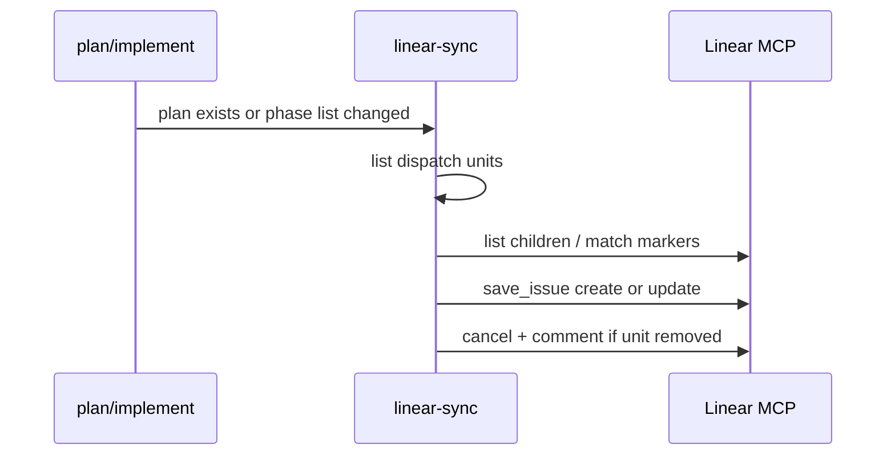

# Linear integration — business logic

> Created because: sync has multi-step workflows, freeze gates, conflict stop, and more than five binding rules.

Rules for **linear-integration**. [spec.md](./spec.md) owns scope, non-goals, glossary, and decisions; cite them in full form (`see D3 (reject bidirectional)`).

## TL;DR

- Linear is a tracker and one-way mirror. The repo stays binding after the folder exists.
- Marked phase children and status sync only when a plan exists, conventions are filled, and Linear MCP works in the session.
- Conflict stop, human-gated Cursor assign, and MCP-session skip keep dual canon, surprise launch, and false cloud sync out of v1.

## Rules

### R1 (conventions gate)

**Lands in:** `skills/spec/stages/create-spec.md` › Input / Write; new `skills/spec/stages/linear-sync.md` › Preconditions

- Before any Linear write-back, the skill MUST read **Work items** under **Project conventions** and require the Linear fields in [contracts.md](./contracts.md) (see D12 (minimal conventions)).
- If Linear MCP or those conventions are missing, the skill MUST ask once and MUST NOT invent a team, state map, or silent half-link (G1 (create from linear), D19 (mcp session), R21 (mcp session)).
- Create-spec MAY still write `spec.md` with `Work item` set after a successful fetch; only the write-back path stops.

### R2 (no body rewrite)

**Lands in:** `skills/spec/stages/create-spec.md` › Write; `skills/spec/stages/linear-sync.md` › Link-back

- The skill MUST NOT replace the parent Linear issue description with the full spec or with binding AC from the repo (G1 (create from linear), G7 (repo canonical), D3 (reject bidirectional)).
- Link-back uses comment, `links` attachment, and optional labels only.

> **Preserve:** Create-spec still maps Linear AC onto goals’ `Source:` lines once at create. It does not paste the raw payload into `spec.md`.

### R3 (first link back)

**Lands in:** `skills/spec/stages/create-spec.md` › Write; `skills/spec/stages/linear-sync.md` › Link-back

- On the first successful link (`Work item` set and write-back allowed), the skill MUST post a comment and/or append a `links` entry pointing at `spec_docs/<slug>/` (G1 (create from linear)).
- When conventions define a design-stage label, the skill MUST add it with `addLabels` (not a full label replace).
- Document mirror create or update follows G5 (document mirror) and D15 (document trigger).

### R4 (freeze before plan)

**Lands in:** `skills/spec/stages/plan.md`; `skills/spec/stages/linear-sync.md` › Child sync

- The skill MUST NOT create phase children while `implementation-plan.md` is missing (G2 (phase children), D4 (freeze after plan)).
- Prefer create/refresh when the plan is written or its phase list changes. Fallback is at or just before first implement.

### R5 (thin noop)

**Lands in:** `skills/spec/stages/linear-sync.md` › Child sync

- If the folder has no `implementation-plan.md`, child structure sync MUST be a no-op (G6 (thin noop)).
- Parent link-back, Progress-based status/labels, and optional Document mirror MAY still run.

### R6 (marked only)

**Lands in:** `skills/spec/stages/linear-sync.md` › Child sync

- Sync MUST create or update only Linear children that carry the durable marker in [contracts.md](./contracts.md) (G2 (phase children), D2 (phase mapping)).
- One marked child maps to one dispatch unit: a plan phase, or one combinable group as a single unit.

### R7 (unmanaged leave)

**Lands in:** `skills/spec/stages/linear-sync.md` › Child sync

- Unmarked children are human-owned. Sync MUST NOT delete, cancel, or rewrite their titles or bodies (G2 (phase children)).

### R8 (idempotent update)

**Lands in:** `skills/spec/stages/linear-sync.md` › Child sync / Reconcile

- Re-sync MUST find children by marker and update in place. It MUST NOT create a duplicate for the same slug + unit id.
- Explicit `/spec linear sync` (reconcile) MUST diff markers against the plan and propose create, cancel, or rename — never silent reshuffle (G3 (status mirror)).

### R9 (cancel removed)

**Lands in:** `skills/spec/stages/linear-sync.md` › Child sync

- When a dispatch unit leaves the plan, sync MUST cancel the marked child and comment with the reason. It MUST NOT silent-delete the issue (G2 (phase children)).

### R10 (flat children)

**Lands in:** `skills/spec/stages/linear-sync.md` › Child sync

- New marked children MUST set `parentId` to the linked parent issue by default (D10 (flat children)).
- Nesting under an Implementation container MUST NOT be the v1 default.

### R11 (status mirror)

**Lands in:** `skills/spec/stages/implement.md` › Phase status / Archive; `skills/spec/stages/linear-sync.md` › Status sync

- Parent Linear state and labels MUST follow `Progress` in `spec.md` via the conventions state map (G3 (status mirror)).
- Marked child state MUST follow that unit’s plan phase status (`Not started` … `Blocked`).
- Linear status MUST NOT drive plan status or Progress (G7 (repo canonical)).

### R12 (auto tracker writes)

**Lands in:** `skills/spec/stages/plan.md`; `skills/spec/stages/implement.md`; `skills/spec/stages/linear-sync.md`

- When Linear is linked and conventions exist, status and marked structure writes MUST run automatically on gate changes and plan status updates (D5 (auto tracker writes)).
- The skill MUST NOT require a confirm prompt on every phase Done.
- Gate review asks in chat MAY add a comment. They MUST NOT invent a Linear approval workflow (G3 (status mirror)).

### R13 (progress log)

**Lands in:** `skills/spec/stages/linear-sync.md` › Status sync

- When Progress or a marked child’s plan status actually changes, sync MUST post a **new** parent comment summarizing what changed (G3 (status mirror), D18 (append progress)).
- Sync MUST NOT edit prior progress comments in place.
- Sync MUST NOT post a progress comment on a no-op reconcile (no Progress / marked-child status delta).

### R14 (conflict stop)

**Lands in:** `skills/spec/stages/linear-sync.md` › Conflict check

- After link, if a human has edited the parent Linear issue body, the skill MUST warn in Cursor and MUST stop before overwriting mirrored surfaces until the person chooses (D6 (conflict stop), D9 (keep conflict stop), G7 (repo canonical)).
- Detection uses the description hash from D16 (conflict fingerprint), stored in `spec.md` per D17 (ids in spec).
- Conflict stop applies before Document regenerate and before any optional description touch. It does not block status-only updates or new progress comments that leave the issue body alone.

### R15 (cloud ready body)

**Lands in:** `skills/spec/stages/linear-sync.md` › Child body; reuses `skills/spec/stages/implement.md` › Phase brief

- Marked child descriptions MUST include brief-quality fields aligned with the implement stage phase brief and env checklist cues (G4 (cloud ready children); archived multi-subagent contracts).
- The body MUST state that the repo is canonical and that the agent MUST NOT invent scope from the Linear description beyond Done when.
- When conventions set a default remote, the body MUST include `[repo=…]` (D14 (default repo)).

### R16 (human gated launch)

**Lands in:** `skills/spec/stages/linear-sync.md` › Child body; `skills/spec/SKILL.md` › Infer table

- v1 MUST use Cursor’s native assign / `@Cursor` path (D7 (native cloud kickoff)).
- The skill MUST NOT auto-assign or auto-`delegate` Cursor on marked children (D13 (human gated)).
- The skill MAY offer “mark ready to delegate” (status/label only). It MUST NOT add a second Cloud Agent launcher API.
- Linear-started cloud inherits cloud consent per multi-subagent G6 (scm consent). Extra branch, worktree, or commit still needs an ask unless that runner’s normal story applies.
- Linear-started cloud MUST NOT be treated as having performed Linear tracker write-back. Catch-up follows D19 (mcp session) / R21 (mcp session).

### R17 (document mirror)

**Lands in:** `skills/spec/stages/linear-sync.md` › Document mirror

- On first successful link, the skill MUST create the Document mirror. It MUST regenerate when a gate change affects TL;DR or goals (G5 (document mirror), D8 (document depth), D15 (document trigger)).
- The Document MUST state it is a mirror: edit binding content in the repo, not in Linear.
- Regeneration is one-way repo → Linear. It MUST NOT pull Linear prose into `spec.md`.
- Status-only updates MUST NOT regenerate the Document.

### R18 (archive gate)

**Lands in:** `skills/spec/stages/implement.md` › Archive; `skills/spec/stages/linear-sync.md` › Status sync

- On archive, the skill MUST set the parent to Done only when every marked child is Done or Deferred (D11 (archive gate)).
- Otherwise it MUST ask before marking the parent Done. Deferred children follow the conventions map.

### R19 (no secrets)

**Lands in:** `skills/spec/stages/linear-sync.md` › All writes

- Sync MUST NOT push secrets, private dumps, or full private docs into Linear comments, children, or Documents (Constraints › Security).
- Document and child text MUST stay summaries and brief fields.

### R20 (routing entry)

**Lands in:** `skills/spec/SKILL.md` › Infer, otherwise ask

- The Infer table MUST recognize `/spec linear sync` (or equivalent reconcile wording) and route to `stages/linear-sync.md` reconcile.
- Stage hooks in create-spec, plan, implement, and archive MUST call the shared sync rules rather than inventing a second doctrine.

### R21 (mcp session)

**Lands in:** `skills/spec/stages/linear-sync.md` › Preconditions; plugin root `README.md`

- Tracker write-back (link-back, children, status, Document, reconcile) and create-from Linear fetch MUST run only when Linear MCP is usable in the current agent session (D19 (mcp session)).
- Cursor’s Linear product integration (assign / `@Cursor`) MUST NOT be treated as Linear MCP auth. Cloud MCP sign-in is separate from the desktop IDE.
- When Linear MCP is missing or unauthorized, the skill MUST follow R1 (conventions gate): ask once and skip write-back. It MUST NOT invent a second Linear API or fail the implement unit solely because Linear could not sync.
- Implement MUST document this operator model in the plugin root `README.md` (Notes › Plugin README in `spec.md`).

## Actors and entry points

| Entry point | User action | System response | Handled by |
| ----------- | ----------- | --------------- | ---------- |
| Create from issue | `/spec create from TEAM-123` | Fetch, write `spec.md`, link-back | `create-spec.md` + `linear-sync.md` |
| Plan written | Promote / plan edit | Child sync when plan exists | `plan.md` + `linear-sync.md` |
| Phase status change | Implement / SDD continue | Child + parent status; progress comment | `implement.md` + `linear-sync.md` |
| Reconcile | `/spec linear sync` | Diff markers; create/cancel/rename | `linear-sync.md` › Reconcile |
| Archive | User confirms archive | Archive gate; parent Done if allowed | `implement.md` › Archive + sync |
| Native cloud | Human assigns / `@Cursor` | Agent reads child brief body; no tracker write-back assumed | Cursor product (not skill launcher); D19 (mcp session) |
| Local catch-up | IDE session with Linear MCP after cloud / plan change | Status, children, Document sync | `linear-sync.md` |

## Workflows

### Create-from and link-back

```mermaid
sequenceDiagram
    participant User
    participant Create as create-spec
    participant Sync as linear-sync
    participant Linear as Linear MCP

    User->>Create: create from TEAM-123
    Create->>Linear: get_issue
    Create->>Create: write spec.md Work item
    Create->>Sync: link-back if conventions OK
    Sync->>Linear: save_comment / links / addLabels
    Note over Sync: Document path per D15; store ids in spec.md
```

1. Fetch issue via conventions → Linear MCP — `create-spec.md` › Input
2. Run create-spec dialogue; write `spec.md` with `Work item` — `create-spec.md` › Write
3. If conventions/MCP missing for write-back: ask once; stop write-back — R1 (conventions gate)
4. Post link-back comment and/or `links`; optional design label — R3 (first link back)
5. Do not rewrite issue description — R2 (no body rewrite)
6. Document create/update — R17 (document mirror); D15 (document trigger)
7. Persist Document id + conflict fingerprint in `spec.md` — D17 (ids in spec)

### Phase child sync



1. Guard: no plan → no-op children — R5 (thin noop)
2. Build dispatch unit list from the plan — R6 (marked only)
3. Match existing children by marker; update or create — R8 (idempotent update)
4. Leave unmarked children alone — R7 (unmanaged leave)
5. Cancel + comment for removed units — R9 (cancel removed)
6. Refresh brief-quality bodies — R15 (cloud ready body)

### Status sync and progress log

1. Map `Progress` → parent state/labels via conventions — R11 (status mirror)
2. Map each marked child’s plan status → Linear state — R11 (status mirror)
3. If Progress or a marked-child status actually changed: post a new progress comment — R13 (progress log)
4. Skip per-Done confirm — R12 (auto tracker writes)

### Conflict stop before mirror overwrite

1. Before Document regenerate (or any body overwrite), run conflict check — R14 (conflict stop), D16 (conflict fingerprint)
2. If human body edit detected: warn in chat; stop mirror overwrite until the person chooses
3. Status updates and new progress comments that do not touch the issue body MAY continue

### Archive gate

1. User confirms archive — `implement.md` › Archive
2. Check every marked child is Done or Deferred — R18 (archive gate)
3. If incomplete: ask; do not silently Done the parent
4. Move folder; set `Progress: archived`; sync parent/labels when allowed

## States and transitions

**In short:** Repo Progress and plan phase status own the truth. Linear states are mapped outputs.

### Parent Progress → Linear (via conventions map)

| From (Progress) | Event | Guard | To (Linear parent) | Side effect |
| --------------- | ----- | ----- | ------------------ | ----------- |
| — | First link | Conventions present | design-stage state/label | Link-back comment / links |
| `design` | Promote tech | Linked | tech map entry | Progress comment |
| `tech` | Promote plan | Linked | plan map entry | Child sync may start |
| `plan` / `implementing` | Gate / phase updates | Linked | implementing map entry | Child status sync |
| any | Archive confirmed | All marked Done/Deferred | Done | Progress comment |
| any | Archive incomplete board | Marked work open | — | Ask; no silent Done |

### Plan phase status → marked child

| From | Event | Guard | To | Side effect |
| ---- | ----- | ----- | -- | ----------- |
| `Not started` | Sync | Marker match | conventions: not started | — |
| any | Unit `Started` | Marker match | conventions: started | Progress comment |
| `Started` | Worker → `Reviewing` | Marker match | conventions: reviewing | Progress comment |
| `Reviewing` | Parent → `Done` | Marker match | conventions: done | Progress comment |
| any | → `Deferred` | Marker match | conventions: deferred | Comment optional |
| any | → `Blocked` | Marker match | conventions: blocked | Progress comment notes reason |
| marked exists | Unit removed from plan | Marker match | Canceled | Cancel comment; R9 |

Exact Linear state *names* live in Project conventions (D12 (minimal conventions)). The table above is the repo-side event model.

## Conditions and error cases

| Rule | Condition | Behaviour | Handled by | User message |
| ---- | --------- | --------- | ---------- | ------------ |
| R1 (conventions gate) | MCP or Linear conventions missing | Stop write-back; ask once | `linear-sync.md` › Preconditions | Ask to fill conventions / connect MCP |
| R21 (mcp session) | Cloud / session without working Linear MCP | Skip write-back; implement may continue | Preconditions + README | Point at local IDE sync / plugin README |
| R2 (no body rewrite) | Tempted to paste full spec into Linear | Reject | Link-back | — |
| R4 (freeze before plan) | Child sync before plan exists | No-op children | Child sync | — |
| R5 (thin noop) | No `implementation-plan.md` | No-op children | Child sync | — |
| R7 (unmanaged leave) | Child lacks marker | Leave alone | Child sync | — |
| R8 (idempotent update) | Structure drift / renumber | Reconcile propose | Reconcile | Show create/cancel/rename plan |
| R14 (conflict stop) | Human edited parent body after link | Warn; stop mirror overwrite | Conflict check | Warn + choices |
| R18 (archive gate) | Marked child not Done/Deferred | Ask before parent Done | Archive + sync | Ask |
| R19 (no secrets) | Secret-like content in mirror payload | Omit / refuse | All writes | — |

## Interactions with existing domain

- **Work items create path** (`skills/spec/stages/create-spec.md` › Input): Same fetch and AC→goal mapping; this feature adds write-back after `Work item` is set.
- **Phase brief** (`skills/spec/stages/implement.md` › Phase brief): Child bodies reuse that field list for native `@Cursor` (archived multi-subagent G2 (phase brief) / G7 (cloud ready brief)).
- **Serial SDD status** (`skills/spec/stages/implement.md` › Phase status): Linear mirrors plan status; it never writes the plan.
- **Project conventions** (`skills/spec/templates/spec-docs-readme.md` › Work items): Schema slots land here; **init project** owns interactive fill UX (Notes in `spec.md`).
- **Bounds / SCM** (`skills/spec/SKILL.md` › Bounds): Unchanged; Linear-started cloud follows multi-subagent consent rules.
