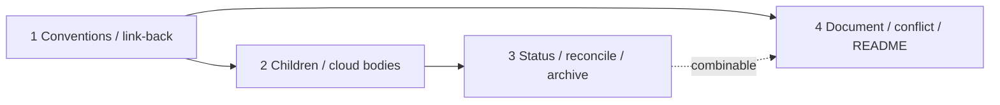

# Linear integration — implementation plan

Phases for [spec.md](./spec.md).

**Status values:** `Not started` · `Started` · `Reviewing` · `Done` · `Deferred` · `Blocked`

## Progress overview

Work-split items 2 and 4’s cloud-ready body are one phase (child description). Document mirror, conflict stop, and operator README are one later phase.

| Phase | Status | Name | Tier | Depends on | Combinable with |
| ----- | ---- | ------ | ---- | ---------- | --------------- |
| **1** | Not started | Conventions and create-from link-back | Medium | — | — |
| **2** | Not started | Marked children and cloud-ready bodies | High | 1 | — |
| **3** | Not started | Status mirror, reconcile, archive | High | 2 | 4 |
| **4** | Not started | Document mirror, conflict stop, README | Medium | 1 | 3 |



## Phase 1 — Conventions and create-from link-back

**Goal:** Create-from can link a Linear issue to a new folder without rewriting the issue body, using conventions and a shared sync helper.

**Covers:** G1 (create from linear), G7 (repo canonical), R1 (conventions gate), R2 (no body rewrite), R3 (first link back), R20 (routing entry), R21 (mcp session)

**Read first:**

- [business-logic.md › R1 (conventions gate)](./business-logic.md#r1-conventions-gate)
- [business-logic.md › R2 (no body rewrite)](./business-logic.md#r2-no-body-rewrite)
- [business-logic.md › R3 (first link back)](./business-logic.md#r3-first-link-back)
- [business-logic.md › R20 (routing entry)](./business-logic.md#r20-routing-entry)
- [business-logic.md › R21 (mcp session)](./business-logic.md#r21-mcp-session)
- [business-logic.md › Create-from and link-back](./business-logic.md#create-from-and-link-back)
- [contracts.md › Linear conventions](./contracts.md#linear-conventions-project-conventions--work-items)
- [contracts.md › Sync ids in spec.md](./contracts.md#sync-ids-in-specmd)
- [contracts.md › Link-back](./contracts.md#link-back)
- [contracts.md › Linear MCP get_issue](./contracts.md#linear-mcp-get_issue)
- [contracts.md › Linear MCP save_issue](./contracts.md#linear-mcp-save_issue)
- [contracts.md › Linear MCP save_comment](./contracts.md#linear-mcp-save_comment)

**Tier:** Medium — first Linear write-back path; MCP ops and field tables are already specified

**Not in this phase:** Marked children; status sync; Document create/regenerate; conflict fingerprint compare; plugin root README Linear section

**Deliverables:**

- `skills/spec/templates/spec-docs-readme.md` — extend: Work items slots for team, fetch blurb, Progress/phase state maps, optional design label and default `[repo=…]`
- `skills/spec/templates/spec.md` — extend: machine fields near `Work item` for Document id and conflict fingerprint (placeholders until first link fills them)
- `skills/spec/stages/linear-sync.md` — new, because: shared sync doctrine reused by create-spec, plan, implement, and reconcile (lifecycle boundary)
- `skills/spec/stages/create-spec.md` — extend: after `Work item` is set, call link-back when write-back is allowed; keep existing AC→goal mapping
- `skills/spec/SKILL.md` — extend: Infer table row for `/spec linear sync` (and equivalent reconcile wording) → `stages/linear-sync.md`

**Approach** (advisory):

1. Fill Work items schema in `templates/spec-docs-readme.md` from the contracts field table. Keep live project fill out of this phase (init-project todo).
2. Add `linear-sync.md` with **Preconditions** (R1 (conventions gate), R21 (mcp session)), **Link-back**, and stubs or “later phase” pointers for Child sync, Status, Document, Conflict, Reconcile so later phases extend one file.
3. Wire create-spec Write: after successful `Work item` set, invoke link-back. On missing MCP/conventions, ask once and still allow `spec.md` write without inventing a team.
4. Link-back: `save_comment` and/or append `links` to `spec_docs/<slug>/`; optional `addLabels` for design-stage label. Never set parent `description` to the spec.
5. Add Infer routing for reconcile. Reconcile body can stay “not implemented until phase 3” if the route exists.

Do:

```text
# link-back may touch
save_comment(issueId, body with repo path)
save_issue(id, links append, addLabels)
```

Do not:

```text
save_issue(id, description: <full spec.md>)
```

### Acceptance scenarios

- **A1.1 — Create-from sets Work item and link-back**
  - Journey: Create a spec from a Linear issue, steps 1–3
  - Given Linear MCP works and Work items conventions are filled
  - When the user creates a spec from `TEAM-123`
  - Then `spec.md` has `Work item` set, Linear gets a comment and/or link to `spec_docs/<slug>/`, and the issue description is unchanged

- **A1.2 — Missing conventions stops write-back only**
  - Journey: Create a spec from a Linear issue, Goes wrong (MCP or conventions missing)
  - Given Work items conventions are still the placeholder, or Linear MCP is missing
  - When create-from would write back
  - Then the skill asks once, skips write-back, and does not invent a team or half-link

- **A1.3 — Reconcile route exists**
  - Journey: —
  - Given the skill Infer table
  - When the user says `/spec linear sync` (or equivalent reconcile wording)
  - Then the skill opens `stages/linear-sync.md` rather than inventing a second doctrine

### Done when

- [ ] Tier verify passes (Project conventions in `spec_docs/README.md`)
- [ ] A1.1–A1.3 pass
- [ ] Create-spec still maps Linear AC onto goals’ `Source:` lines and does not paste the raw payload into `spec.md`
- [ ] No HTML author comments or `{{…}}` left in touched skill/template files

### Close-out

- Verified:
- Deviations:
- Follow-ups:

## Phase 2 — Marked children and cloud-ready bodies

**Goal:** After a plan exists, sync creates or updates one marked Linear child per dispatch unit with brief-quality text; planless folders stay childless.

**Covers:** G2 (phase children), G4 (cloud ready children), G6 (thin noop), R4 (freeze before plan), R5 (thin noop), R6 (marked only), R7 (unmanaged leave), R8 (idempotent update), R9 (cancel removed), R10 (flat children), R15 (cloud ready body), R16 (human gated launch)

**Read first:**

- [business-logic.md › R4 (freeze before plan)](./business-logic.md#r4-freeze-before-plan)
- [business-logic.md › R5 (thin noop)](./business-logic.md#r5-thin-noop)
- [business-logic.md › R6 (marked only)](./business-logic.md#r6-marked-only)
- [business-logic.md › R7 (unmanaged leave)](./business-logic.md#r7-unmanaged-leave)
- [business-logic.md › R8 (idempotent update)](./business-logic.md#r8-idempotent-update)
- [business-logic.md › R9 (cancel removed)](./business-logic.md#r9-cancel-removed)
- [business-logic.md › R10 (flat children)](./business-logic.md#r10-flat-children)
- [business-logic.md › R15 (cloud ready body)](./business-logic.md#r15-cloud-ready-body)
- [business-logic.md › R16 (human gated launch)](./business-logic.md#r16-human-gated-launch)
- [business-logic.md › Phase child sync](./business-logic.md#phase-child-sync)
- [contracts.md › Spec sync marker](./contracts.md#spec-sync-marker-marked-child)
- [contracts.md › Marked child body](./contracts.md#marked-child-body-cloud-ready)
- [contracts.md › Sync children](./contracts.md#sync-children)
- [contracts.md › Native Cursor assign / @Cursor](./contracts.md#native-cursor-assign--cursor)

**Tier:** High — many interacting ownership rules; child body is a contract other agents rely on

**Not in this phase:** Parent/child status maps; progress comments; Document mirror; conflict stop; reconcile apply UI beyond what child sync needs for create/update/cancel

**Deliverables:**

- `skills/spec/stages/linear-sync.md` — extend: Child sync (create/update/cancel-by-marker), child body builder aligned with implement Phase brief
- `skills/spec/stages/plan.md` — extend: after plan write or phase-list change, trigger child sync when linked and conventions allow
- `skills/spec/stages/implement.md` — extend: note that marked child bodies reuse Phase brief / Env checklist fields; fallback child sync at or just before first implement when plan exists and children are missing

**Approach** (advisory):

1. Build dispatch units from the plan overview: one unit per phase, or one unit for a combinable group (same meaning as multi-subagent).
2. Match existing children by `<!-- spec-sync: slug=… unit=… -->`. Same key → update. Missing → create with `parentId` = linked parent. No plan → no-op children.
3. Leave unmarked children untouched. Removed units → cancel marked child + comment; never silent delete.
4. Body after the marker: canon banner, unit identity, Done when summary, paths / Read first cues, stop-after-this-unit, env cues, optional `[repo=…]` from conventions.
5. Do not auto-assign Cursor. Skill may mention “mark ready to delegate” as status/label only.

Marker shape (binding):

```text
<!-- spec-sync: slug=linear-integration unit=2 -->
```

### Acceptance scenarios

- **A2.1 — Plan creates marked children**
  - Journey: Plan phases appear as Linear children, steps 1–2
  - Given a linked folder with a new `implementation-plan.md` and write-back allowed
  - When plan sync runs
  - Then one marked child exists per dispatch unit with the sync marker and brief-quality body

- **A2.2 — Thin / planless is a no-op for children**
  - Journey: Plan phases appear as Linear children, step 4
  - Given a linked folder with no `implementation-plan.md`
  - When structure sync runs
  - Then no phase children are created

- **A2.3 — Re-sync is idempotent; unmanaged left alone**
  - Journey: Plan phases appear as Linear children, Goes wrong (duplicates / human children)
  - Given marked children already exist and an unmarked human child is present
  - When sync runs again
  - Then marked children update in place with no duplicates, and the unmarked child is unchanged

- **A2.4 — Removed unit cancels with comment**
  - Journey: —
  - Given a marked child for a unit that left the plan
  - When sync runs
  - Then that child is canceled with a reason comment, not silently deleted

- **A2.5 — Child body forbids inventing scope**
  - Journey: Start cloud work from Linear, Goes wrong (stale Linear AC)
  - Given a refreshed marked child
  - When an agent reads the child description
  - Then the body states the repo is canonical and Done when bounds scope; no skill Cloud Agent launcher is introduced

### Done when

- [ ] Tier verify passes (Project conventions in `spec_docs/README.md`)
- [ ] A2.1–A2.5 pass
- [ ] Child body field list stays aligned with `stages/implement.md` › Phase brief / Env checklist
- [ ] Children are never created while `implementation-plan.md` is missing

### Close-out

- Verified:
- Deviations:
- Follow-ups:

## Phase 3 — Status mirror, reconcile, and archive gate

**Goal:** Linear parent and marked-child states follow repo Progress and plan status automatically; reconcile recovers drift; archive respects marked-child completion.

**Covers:** G3 (status mirror), R8 (idempotent update), R11 (status mirror), R12 (auto tracker writes), R13 (progress log), R18 (archive gate)

**Read first:**

- [business-logic.md › R11 (status mirror)](./business-logic.md#r11-status-mirror)
- [business-logic.md › R12 (auto tracker writes)](./business-logic.md#r12-auto-tracker-writes)
- [business-logic.md › R13 (progress log)](./business-logic.md#r13-progress-log)
- [business-logic.md › R18 (archive gate)](./business-logic.md#r18-archive-gate)
- [business-logic.md › Status sync and progress log](./business-logic.md#status-sync-and-progress-log)
- [business-logic.md › Archive gate](./business-logic.md#archive-gate)
- [business-logic.md › States and transitions](./business-logic.md#states-and-transitions)
- [contracts.md › Progress-log marker](./contracts.md#progress-log-marker)
- [contracts.md › Sync status](./contracts.md#sync-status)
- [contracts.md › Reconcile](./contracts.md#reconcile)

**Tier:** High — lifecycle across gates; append-only timeline; archive incomplete-board ask

**Not in this phase:** Document regenerate; conflict fingerprint; child create rules already shipped in phase 2; plugin README

**Deliverables:**

- `skills/spec/stages/linear-sync.md` — extend: Status sync, progress-log comments, Reconcile (diff markers vs plan; propose create/cancel/rename; apply on confirm)
- `skills/spec/stages/implement.md` — extend: on phase status changes and archive, call status sync; no confirm prompt on every Done; archive gate before parent Done
- `skills/spec/stages/plan.md` — extend: Progress/gate write-back hooks if not already covered when plan lands (parent map entry)

**Approach** (advisory):

1. Map `Progress` → parent state/labels and plan phase status → marked child state via conventions maps. Linear never writes the plan.
2. On a real Progress or marked-child status delta, `save_comment` a **new** parent comment with `<!-- spec-sync-progress: slug=… -->`. Never edit prior progress comments. Skip comments on no-op reconcile.
3. Day-to-day sync stays automatic (R12 (auto tracker writes)). `/spec linear sync` shows a create/cancel/rename plan and applies only after the user confirms that reconcile plan.
4. Archive: parent Done only when every marked child is Done or Deferred; otherwise ask.

### Acceptance scenarios

- **A3.1 — Phase status mirrors to marked children**
  - Journey: Status stays aligned during implement, steps 1–2
  - Given a linked plan with marked children and conventions maps filled
  - When a phase moves `Started` / `Reviewing` / `Done` / `Blocked`
  - Then the matching marked child state updates without a confirm prompt each time

- **A3.2 — Progress comment on real change only**
  - Journey: Status stays aligned during implement, step 2
  - Given a real Progress or marked-child status change
  - When status sync runs
  - Then a new parent progress comment is posted; a second sync with no delta posts none

- **A3.3 — Linear does not drive the plan**
  - Journey: Status stays aligned during implement, Goes wrong (Linear as driver)
  - Given someone changes a Linear child state in the board
  - When the skill runs
  - Then plan phase status and `Progress` are not overwritten from Linear

- **A3.4 — Reconcile proposes structure fixes**
  - Journey: —
  - Given marker/plan drift (renumber or missing child)
  - When the user runs `/spec linear sync`
  - Then the skill proposes create/cancel/rename and does not silent-reshuffle before confirm

- **A3.5 — Archive gate**
  - Journey: Status stays aligned during implement, End state / archive
  - Given archive is confirmed but a marked child is still open
  - When the skill would mark the parent Done
  - Then it asks instead of silently completing the parent

### Done when

- [ ] Tier verify passes (Project conventions in `spec_docs/README.md`)
- [ ] A3.1–A3.5 pass
- [ ] No per-Done Linear confirm prompt remains in implement status hooks
- [ ] Progress comments are append-only (no edit-in-place path)

### Close-out

- Verified:
- Deviations:
- Follow-ups:

## Phase 4 — Document mirror, conflict stop, and operator README

**Goal:** Linear-only readers get a regenerable Document mirror; human body edits stop overwrite; operators know local MCP sync vs `@Cursor` kickoff.

**Covers:** G5 (document mirror), R14 (conflict stop), R17 (document mirror), R19 (no secrets), R21 (mcp session)

**Read first:**

- [business-logic.md › R14 (conflict stop)](./business-logic.md#r14-conflict-stop)
- [business-logic.md › R17 (document mirror)](./business-logic.md#r17-document-mirror)
- [business-logic.md › R19 (no secrets)](./business-logic.md#r19-no-secrets)
- [business-logic.md › Conflict stop before mirror overwrite](./business-logic.md#conflict-stop-before-mirror-overwrite)
- [contracts.md › Document mirror content](./contracts.md#document-mirror-content)
- [contracts.md › Sync ids in spec.md](./contracts.md#sync-ids-in-specmd)
- [contracts.md › Linear MCP save_document / get_document](./contracts.md#linear-mcp-save_document--get_document)
- [spec.md › Notes › Plugin README](./spec.md#notes)
- [spec.md › D15 (document trigger)](./spec.md#d15-document-trigger--create-document-on-first-link-regenerate-when-tldr-or-goals-change)
- [spec.md › D16 (conflict fingerprint)](./spec.md#d16-conflict-fingerprint--hash-the-parent-description-at-link-time-compare-before-overwrite)
- [spec.md › D19 (mcp session)](./spec.md#d19-mcp-session--tracker-write-back-only-in-sessions-with-working-linear-mcp)

**Tier:** Medium — conflict stop before Document overwrite; README is mechanical once the operator model is fixed

**Not in this phase:** Child structure rules; status maps; inventing a skill Cloud Agent launcher; filling adopter Project conventions (init-project)

**Deliverables:**

- `skills/spec/stages/linear-sync.md` — extend: Conflict check (description hash), Document create on first link, regenerate when TL;DR or goals change; persist Document id + fingerprint in `spec.md`
- `skills/spec/stages/create-spec.md` — extend: first-link path also creates Document when write-back allowed (D15 (document trigger))
- `README.md` — extend: Linear (or Work items) operator section — connect Linear MCP in IDE; fill conventions; create-from/sync locally; native `@Cursor` for cloud; do not expect cloud alone to sync Linear; optional note on cloud Linear MCP OAuth

**Approach** (advisory):

1. On first successful link: hash parent `description`, store fingerprint in `spec.md`; create Document (TL;DR + goals/AC summary + mirror banner); store Document id.
2. Before Document regenerate (or any body overwrite): re-fetch, re-hash, compare. Match → proceed. Mismatch → warn and stop until the person chooses; on resolve, refresh the stored hash. Status-only updates and new progress comments that leave the body alone may continue.
3. Regenerate Document when TL;DR or goals change; not on status-only ticks. Never pull Linear prose into `spec.md`.
4. Plugin README documents local MCP write-back vs Linear product kickoff (D19 (mcp session)).

### Acceptance scenarios

- **A4.1 — Document created on first link**
  - Journey: Create a spec from a Linear issue, step 4; Linear-only review of design, steps 1–2
  - Given write-back allowed on first link
  - When link-back completes
  - Then a Linear Document exists on the parent with mirror banner, TL;DR, and goals/AC summary, and its id is stored in `spec.md`

- **A4.2 — Regenerate on summary change, not status-only**
  - Journey: Linear-only review of design, step 3
  - Given Document id is stored and TL;DR or goals changed in the repo
  - When sync runs after that change versus after a status-only change
  - Then Document content refreshes for the summary change and does not regenerate for status-only

- **A4.3 — Conflict stop before overwrite**
  - Journey: Linear-only review of design, Goes wrong (edit as AC truth)
  - Given a human edited the parent Linear description after link
  - When Document regenerate would run
  - Then the skill warns, stops overwrite, and still allows status-only updates that leave the body alone

- **A4.4 — Operator README states kickoff ≠ sync**
  - Journey: Start cloud work from Linear, Goes wrong (expect cloud alone to sync)
  - Given the plugin root `README.md`
  - When an operator reads the Linear section
  - Then it states local IDE + Linear MCP for write-back, native `@Cursor` for kickoff, and that cloud alone must not be assumed to sync Linear

### Done when

- [ ] Tier verify passes (Project conventions in `spec_docs/README.md`)
- [ ] A4.1–A4.4 pass
- [ ] Document and child/comment payloads stay summaries — no secrets or full private dumps
- [ ] Missing Linear MCP still asks/skips write-back without failing an implement unit solely for sync

### Close-out

- Verified:
- Deviations:
- Follow-ups:

## Risks

- **Cloud checkout status lag.** Plan status on a cloud agent checkout may not match Linear until merge and a later MCP-capable sync. Mitigation: implement/status copy notes catch-up; do not treat Linear as ahead of the repo.
- **Adopter conventions empty.** Until init-project or a human fills Work items, write-back stays ask-and-skip. Mitigation: schema lands in the template in phase 1; do not invent team maps in skill code.
